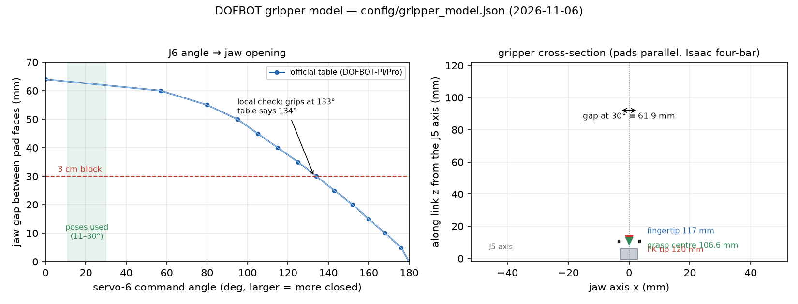

# 夹爪与整臂建模：几何、开口曲线、TCP 与误差预算

更新：**2026-11-06**。范围：夹爪（6 号舵机 + 两指）与整臂的**建模数据和来源**，以及现在还差哪些实测。
本文的口径沿用[工作区总览](README.md)：`官方规格`（厂商参数表）> `官方文档表格`（厂商教程给出的标定表）>
`官方模型`（厂商/NVIDIA 发布的 URDF/USD）> `本机实测`（这台臂上测到的数）> `推断`（由前几项算出）。

**一句话**：夹爪的“开口宽度—舵机角”现在有官方 14 点标定表可用（且与本机 3 cm 抓取点吻合到 1°）；
真正让测算偏 1 cm 量级的不是开口，而是**抓取点/TCP 的定义**（4 个不同的“尖”）和**J4→J5 连杆长度
在 URDF 与官方 Isaac 模型之间差 8.35 mm** 这两件事。两者都能用半小时的实机标定定死，第 7 节给了步骤。

本文所有数都带来源；没有任何一条是“今天在这台臂上新测的”。新增脚本和参数模型已入库，但**没有改动任何
现有控制路径**（原因见第 6 节）。

---

## 1. 现在项目里夹爪是怎么被“算”的

| 位置 | 现在用的模型 | 问题 |
|---|---|---|
| [`src/spatial/dofbot_kinematics.py`](../../src/spatial/dofbot_kinematics.py) | 夹爪 = 沿最后连杆 0.12 m 的一根直线，`tip` 就是这根线的端点 | 0.12 m 是上游 `dofbot_server.cpp` 的常量，不是几何量；官方 URDF 根本没有夹爪 |
| 抓取规划 [`src/tasks/console_grasp.py`](../../src/tasks/console_grasp.py) | 在 `tip` 上再加一个经验补偿：`open_grasp_radial_offset_cm = 1.0`，随 J5 转 | 补偿方向/大小来自 2026-09-25/26 的操作员目视对正，**没有几何模型支撑** |
| 禁入区 [`src/spatial/workspace.py`](../../src/spatial/workspace.py) | 夹爪包络 = 5 号轴心到 12 cm 的一根线，左右各 2.5 cm | 半宽 2.5 cm 与真实 3.4 cm 外跨不符；长度也偏长 |
| 仿真 [`src/sim/world.py`](../../src/sim/world.py) | 抓取判定：tip 到物块中心水平 ≤2 cm、高度在物块顶面附近；碰撞用 5–12 cm 的采样点 | 对 3 cm 物块够用，但夹爪张开姿态与包络没有建模 |
| 夹爪角 | [`config/arm_limits.json`](../../config/arm_limits.json) `gripper` 段 | 只有 3 cm 一个接触点（命令 133°、读回 124–128°）和 11/30° 两个开口预设，没有开口宽度 |

所以“测算误差大”不是某一处写错，而是**夹爪只有一个长度和一个经验偏移**，没有可校核的几何。

## 2. 数据来源

| 来源 | 内容 | 证据等级 | 本地文件 / 链接 |
|---|---|---|---|
| 纸质说明书第 9 页（用户拍照） | 6 号舵机 6 kg·cm@6 V、180°±10°、塑料齿轮、堵转 1.7 A、40.6×20×41.8 mm | 官方规格 + 本机核对一致 | 根目录 `微信图片_20260924193652_22_63.jpg`；[01-设备与课程](01-设备与课程.md#L40) |
| DOFBOT-Pi / DOFBOT-Pro 官方教程 | **舵机角 ↔ 可夹物体宽度** 14 点表（0 cm→180° … 6.0–6.4 cm→0–57°）；3 cm 方块用 134° | 官方文档表格 | <https://www.yahboom.net/study/Dofbot-Pi/15480>、<https://www.yahboom.net/study/DOFBOT-Pro/17606/> |
| 上游 `dofbot.urdf`（提交 `9d10827`） | 5 个 revolute，无夹爪；逐关节 origin/limit | 官方模型 | [导入审计](06-官方源码导入审计.md#L22) |
| Isaac Sim Yahboom Dofbot `dofbot.usd` | 完整夹爪：每指 3 段铰接指 + 四连杆；J5→指尖、指节尺寸、默认开口 | 官方模型（第三方构建） | `data/reference/isaac_dofbot/dofbot.usd`（[SOURCE.md](../../data/reference/isaac_dofbot/SOURCE.md)） |
| 六个 STL（课程包） | `link5.STL` 已含两指，指尖到自身原点 11.11 cm | 官方模型 | `资料/展开资源/三维结构文件/三维结构文件/` |
| 本机实测 | 3 cm 物块命令 131° 接触、回退 124° 稳定、夹取命令 133°；空合到 170° 无接触；全开 11°、常用 30°；抓取时张开指尖中点偏 J5 轴 1.15 cm | 本机实测 | `data/runs/gripper_calibration.jsonl`、[05-硬件实测](../05-板卡连接与硬件实测.md) |

检索明细（每条数字的原文引用、互相矛盾的说法、查不到的项）在[夹爪资料与来源](27a-夹爪资料与来源.md)。

## 3. 整臂几何：URDF vs 官方 Isaac 模型

| 段 | 上游 URDF | Isaac USD | 差 |
|---|---|---|---|
| base → J1 | 64.0 mm | 66.05 mm | +2.05 mm |
| J1 → J2（肩） | 43.5 mm | 41.45 mm | −2.05 mm |
| J2 → J3（上臂） | 82.85 mm | 82.85 mm | 0 |
| J3 → J4（前臂） | 82.85 mm | 82.85 mm | 0 |
| J4 → J5（腕） | **73.85 mm** | **65.50 mm** | **−8.35 mm** |
| J5 → 指尖 | 120.0 mm（代码常量） | 116.99 mm | −3.0 mm |
| 合计 base → 指尖 | 467.05 mm | 455.7 mm | −11.35 mm |

这与[硬件实测](../05-板卡连接与硬件实测.md) 2026-09-26 的结论一致：竖直姿态下 USD 的 J5 轴高 33.87 cm
（我们模型 34.7 cm）、指尖 45.57 cm（我们 46.7 cm），差 1.1 cm；当时判断“包络长度差被触点标定吸收”。
**但 8.35 mm 的差在 J4→J5，不在夹爪**——这会在俯角变化时表现为系统性偏移，而不是一个常数。

> 待定：URDF 的 73.85 mm 与 USD 的 65.50 mm 哪个是这台臂的真值。现有 5 个触点姿态的俯角都在
> 149–162°，两者与“桌高/地图前后位置”强相关，分不开（当时残差都是 0.27–0.28 cm）。要定死，必须
> 在**俯角 120°/135°/150°/165°** 各补一个触桌点（第 7 节步骤 2）。

## 4. 夹爪几何（Isaac USD 实测提取）

提取脚本：[`scripts/extract_isaac_dofbot.py`](../../scripts/extract_isaac_dofbot.py)（`UV_CACHE_DIR=$PWD/.uv-cache
uv run --with usd-core --with numpy python scripts/extract_isaac_dofbot.py`，输出
`data/reference/isaac_dofbot/geometry.json` 与 `meshes/*.obj`）。

| 量 | 数值 | 说明 |
|---|---|---|
| J5 轴 → 指尖最高点 | 116.99 mm | 上游 IK 用 120 mm |
| 指尖最高点 → 完全闭合（估算） | ≈111 mm | 平行四边形连杆闭合时指尖回缩约 6 mm；`link5.STL` 指尖到自身原点 11.11 cm 与此吻合 |
| 指根转轴位置 | z = 41.9 mm，x = ±12.3 mm，y = −5.5 mm | 相对 J5 轴 |
| 每指四连杆 | 机架 19.6 / 曲柄 30.0 / 连杆 30.1 / 摇杆 20.0 mm | **平行四边形**：两指保持平行，只做平移开合 |
| 指垫（远端指节） | 长 21.0 mm、厚 6 mm、宽 20 mm；z 从 96.3 到 116.9 mm | 夹持面是**平行**的，沿整块垫子间隙相同 |
| 默认姿态（USD 驱动器 0） | 两指内间距 **35.86 mm**，外跨 **68.37 mm** | 不是舵机的闭合位，不能直接当开口 |
| 腕部 / 夹爪座包络 | 54.7 × 55.5 × 69.0 mm | 替换现在 `hull_half_width 25 mm` 的候选 |
| 驱动 | 只用 `Finger_0x_01` 的 revolute（stiffness 6000 / damping 1000 / maxForce 0.12），无 gear/mimic；左右两片扇形齿轮啮合 | 建模时按**一个开合自由度**即可 |

四个连杆的复算脚本：[`data/analysis/gripper_loop.py`](../../data/analysis/gripper_loop.py)（数据目录不入库，脚本可复现）。
注意 USD 的 joint `localPos` 单位是 cm、stage 是 m，脚本里已按 cm 处理。

## 5. 开口曲线：舵机角 → 两指内间距

官方表（0.5 cm 一档，原文未改写）：

| 物体宽 cm | 0 | 0.5 | 1.0 | 1.5 | 2.0 | 2.5 | **3.0** | 3.5 | 4.0 | 4.5 | 5.0 | 5.5 | 6.0 | 6.0–6.4 |
|---|---|---|---|---|---|---|---|---|---|---|---|---|---|---|
| 舵机角 ° | 180 | 176 | 168 | 160 | 152 | 143 | **134** | 125 | 115 | 105 | 95 | 80 | 57 | 0–57 |

- 方向：**角度越大越闭合**（0° 全开 6.4 cm，180° 闭合 0）。
- 本机校验：3 cm 物块本机命令 **133°** 夹住，官方写 **134°**，差 1° → 角度语义和机构齿比一致。
- 空合到 170° 仍无接触（读回跟随、不迟滞），按表此时间隙约 8.8 mm——**不是** 0；项目里
  `empty_closes_freely_to_deg: 170` 只是标定脚本的停止角，不是机械闭合角。
- 接触时读回比命令低 **4–9°**（命令 131–133 → 读回 124–128），这是塑料齿轮/舵机柔顺造成的软差。
  **不要用接触读回反推开口**，否则系统性偏小。

曲线已参数化：[`config/gripper_model.json`](../../config/gripper_model.json) `jaw.points`，
代码接口 [`src/spatial/gripper_model.py`](../../src/spatial/gripper_model.py)：



```bash
python3 src/spatial/gripper_model.py table          # 角度 → 开口
python3 src/spatial/gripper_model.py check 0.03 30  # 3 cm 物块在 30° 时是否放得下（+1 cm 余量）
```

**模型不确定性（重要）**：同一款机器人的 Isaac 模型最大只开到 **44.7 mm**，指垫默认间距 35.9 mm；
官方表却到 64 mm。两者在 ≤45 mm 段一致，只影响 5.5–6.4 cm 的大物体。本项目抓 3 cm 物块，
11–30° 的开口在两种解释下都 ≥62 mm / ≥44 mm，**都够**；但不要用“最大开口 64 mm”去做安全论证，
除非第 7 节步骤 1 用卡尺确认。

## 6. TCP / 抓取点：四个“尖”必须区分

| 名字 | 距 J5 轴 | 来源 | 用途 |
|---|---|---|---|
| `fk_tip` | 120.0 mm | 上游常量，`dofbot_kinematics.GRIPPER` | 现有全部代码；触点标定就是按它做的 |
| `fingertip` | 116.99 mm | Isaac USD 指尖最高点 | 真实指尖，碰撞/URDF |
| `grasp_centre` | 106.6 mm | 指垫中点（垫子 z 96.3–116.9 mm 的中点） | 物块中心该放的位置（几何） |
| `empirical_offset` | 120 mm + (0, 11.5, 0) mm | 2026-09-25/26 操作员对正 + 配置里的 1.0 cm 径向补偿 | 现有抓取路径实际用的点 |

- `empirical_offset` 的 11.5 mm 在夹爪横截面（y）方向，所以**随 J5 转动**——这与操作员在 160° 滚转后
  “补偿方向翻到另一侧”的观察一致。
- `grasp_centre` 在连杆方向（−z），**不随 J5 转**。两者量级只差 2 mm（11.5 vs 13.4），方向不同；
  这正是“测算总差 1 cm”的来源。哪个是对的，用第 7 节步骤 3 的日志拟合一次就能分开。
- 现有抓取能成功，是因为指垫有 21 mm 长、物块 30 mm，容差吃掉了这 1 cm 的方向歧义。

## 7. 误差预算与还差的标定

| 误差项 | 量级 | 现在知不知道 | 怎么定 |
|---|---|---|---|
| 抓取点（TCP）定义不一致 | **10–13 mm** | 知道有两个候选，未定 | 步骤 3 |
| J4→J5 连杆长度 URDF vs USD | **8.4 mm** | 未定 | 步骤 2 |
| 夹爪“长 3 mm”（120 vs 117） | 3 mm | 已知偏长 | 步骤 2 顺带拟合 |
| 接触读回软差 4–9° | 反推开合约 2–6 mm | 已知 | 只用命令角，已写进模型 |
| 开口模型变体（45 vs 64 mm） | >45 mm 段不可用 | 未定 | 步骤 1（10 分钟） |
| 桌高/地图 | 残差 2.8 mm | 已标定 | 换地图要重做 |
| 关节随机残差 | ≈1.2° | 已知 | 每次抓取回读校验 |

**步骤 1（10 分钟，卡尺）**：夹爪空载，依次命令 0/30/60/90/120/150/180°，每步等 1 s 读回，
用卡尺量两指内侧面间距。目的：确认最大开口是 64 mm 还是 45 mm 变体，并把 `jaw.points` 的
实测段替换成真值。

**步骤 2（20 分钟，触桌，3–4 个点）**：保持夹爪闭合，分别在俯角 **120/135/150/165°** 让指尖轻触桌面，
记录首次接触的读回姿态。用这 4 点 + 原有 5 点联合最小二乘，同时拟合：J4→J5 长度、夹爪长度、
桌高、地图前后位置。现有触点全在 149–162°，这四个数分不开，所以以前“长度取多少残差都一样”。

**步骤 3（离线，已有数据）**：用 `data/runs/console_grasp/log.jsonl` 里 39 次 `holding` 的抓取姿态，
对比正解与物块定位（board/phone 两路），把残差投影到夹爪坐标系，得到 3D 偏置向量。脚本尚未写
（原计划 `scripts/fit_grasp_offset.py`）；先把步骤 1/2 的数拿到再拟合，否则定位误差会混进偏置里。

## 8. 这次新增的产物

| 产物 | 内容 | 状态 |
|---|---|---|
| [`config/gripper_model.json`](../../config/gripper_model.json) | 开口曲线 14 点、几何、4 个 TCP 定义、包络、每条数据的来源与证据等级 | 新增，未被控制路径读取 |
| [`src/spatial/gripper_model.py`](../../src/spatial/gripper_model.py) | `jaw_gap_m` / `servo6_for_gap` / `fits` / `pad_boxes` / `grasp_point`（empirical/geometric/fingertip）/ `envelope_points` + 命令行 | 新增，纯 stdlib |
| [`tests/test_gripper_model.py`](../../tests/test_gripper_model.py) | 15 项：端点、单调性、3 cm→134°、平行四边形垫子、三种 TCP 的距离关系 | 新增，全过 |
| [`scripts/extract_isaac_dofbot.py`](../../scripts/extract_isaac_dofbot.py) | 从 USD 提取关节锚点/包围盒/手指网格（OBJ） | 新增，可复跑 |
| [`scripts/build_dofbot_urdf.py`](../../scripts/build_dofbot_urdf.py) + [`config/urdf/dofbot_with_gripper.urdf`](../../config/urdf/dofbot_with_gripper.urdf) | 完整 URDF：5 臂关节 + 2 个 mimic 平移指 + `grasp_centre`/`fingertip` 标记帧 | 新增，XML 可解析 |
| [`data/analysis/gripper_loop.py`](../../data/analysis/gripper_loop.py) | 四连杆复算（数据目录，不入库） | 新增，可复跑 |

URDF 用法：`python3 scripts/build_dofbot_urdf.py`（默认引用 `资料/` 里的 STL；`--no-meshes` 只出
基本体；`--j5 0.0655` 生成 Isaac 口径的腕长变体）。

## 9. 有意没做的事

1. **没有把 `dofbot_kinematics.GRIPPER` 从 0.12 改成 0.117**。桌高和地图摆放都是按 0.12 拟合的
   （`base_from_map` 与 `table_surface_z_m`），单独改长度会让所有已标定的 z 平移 3 mm；应当和
   步骤 2 一起重标，而不是半改。
2. **没有替换禁入区的夹爪包络**。现有 `keep_out` 是在真实接触样本之间拟合的（安全运动最小余量
   +1.7 cm、两次接触至少越界 1.9 cm）；第 4 节的 6.84 cm 外跨和 5.5×5.5×6.9 cm 壳体虽然更真，
   但没有重跑接触样本之前不能换，否则是拿安全换精度。
3. **没有把模型接进仿真和抓取规划**。接的地方已经列在模块 docstring 里；等步骤 1–3 的数回来再接。
4. **没有做任何新的实机动作**。本文所有“本机”数字都来自既有日志和文档。

## 10. 参考

- 官方开口表：<https://www.yahboom.net/study/Dofbot-Pi/15480>、<https://www.yahboom.net/study/DOFBOT-Pro/17606/>
- 6 号舵机规格：<https://www.yahboom.store/blogs/news/unboxing-reviewing-dofbot-pro>
- Isaac 资产来源：[SOURCE.md](../../data/reference/isaac_dofbot/SOURCE.md)、<https://docs.isaacsim.omniverse.nvidia.com/latest/assets/usd_assets_robots_manipulator.html>
- 本机事实：[05-板卡连接与硬件实测](../05-板卡连接与硬件实测.md)（夹爪标定、触点标定、Isaac 对照）
- 资料明细：[27a-夹爪资料与来源](27a-夹爪资料与来源.md)
