# 智能机械臂垃圾分拣与管理系统 · 中期汇报（设计详述）

汇报日期：2026-11-20｜成员：赵杰雄、张浩然、刘子怡、王敏毓
硬件：昇腾 Atlas 200I DK A2（Ascend 310B1 NPU）+ Dofbot 六舵机机械臂 + 腕部单目相机
配套 PPT：[中期汇报.pptx](中期汇报.pptx)（由 [build_ppt.js](build_ppt.js) 生成），配图在 [figures/](figures/)

> **状态口径**：本文逐项区分三种状态：**实机实测**（附日期和记录）、**仿真 / 离线验证**、**设计值或只是文件存在**。仿真结果只说明几何和接口能对上，不代表实机成功率。引用 `data/` 下的本地日志时会单独注明，因为 `data/` 不入库。

## 目录

1. 人员分工与完成情况
2. 整体架构
3. 地图迭代
4. 垃圾桶建模与亚克力图纸
5. 垃圾桶实机测试
6. YOLO 检测模型训练
7. 从检测到物块中心与朝向
8. 手势识别模型
9. 仿真模型
10. 路径解算到回传
11. 板卡端
12. 流程管线与 YAML 设计
13. 接口设计
14. 网页前端
15. 手机 App
16. 后续开发方向

## 人员分工与完成情况

沿用需求审查时确定的四人方案：硬件组 2 人，前端组 2 人，**四人工作量各占 25%**。

| 成员 | 角色 | 占比 | 负责内容 |
|---|---|---|---|
| 赵杰雄 | H1 感知与执行 | 25% | 四类检测模型与板上推理、多视角定位与棱边解算、抓取与投放、路径解算与碰撞规划、失败兜底、仿真后端、日志契约、流程编排、系统集成 |
| 张浩然 | H2 外设与交互 | 25% | 亚克力垃圾桶与标定、声光反馈、堵转保护、溢满检测、手势交互与识别桥、预设动作、上板部署与实机调参 |
| 刘子怡 | F1 电脑端前端 | 25% | 板载网关对外服务、作业台与功能页、控制面板与三维视图、流程脚本编辑、定时启动、告警页 |
| 王敏毓 | F2 手机端与数据 | 25% | Android App（跳板、双摇杆、任务页）、分拣记录与统计、Excel/CSV 导出、前端测试与日志回放 |

**完成情况**：基础四项（识别定位、任意位置抓取、网页实时日志、失败自动处理）已完成，整体流程已在板上跑通。扩展功能中，实体桶投放、控制面板、三种作业模式、记录导出（前端界面补充中）、定时启动、声光、堵转保护、就近优先、未知物体告警、溢满检测、手势交互、手机端都已完成；**尚未完成的是语音控制的麦克风收音和堆叠抓取**。

## 整体架构

系统分成三端：**板卡端**负责执行和安全，**网页前端**和 **Android App** 只发指令、看状态。中间用一部安卓手机做网络跳板。原则有四条（[31](../../current/31-板载端分离与中继通信.md) §1、[32](../../current/32-操作逻辑简化与分步任务.md) §0）：

1. **执行与安全全部留在板上。** 限位、禁入区、桌面余量、租约（死人开关）、分段回读都只在控制台里实现一次。网关、网页、App 都不重复做安全判断：控制台拒绝什么，就把中文原因原样显示出来。
2. **对外只开一个口。** 控制台和相机服务只给本机进程用。外部的网页、App、开发机一律经板载网关 `:8090` 访问。
3. **中继只转发网络，不跑业务。** 跳板 App 只做 TCP 转发（:8090、:2222），换一台中继不需要改业务代码。
4. **仿真与实机是同一等级的执行侧。** `dev/sim/sim_server.py` 和控制台答同一套 `/api/*`，网关用 `--console` 指向它，就得到一个“仿真板载端”。前端和 App 里没有 `if sim` 分支。

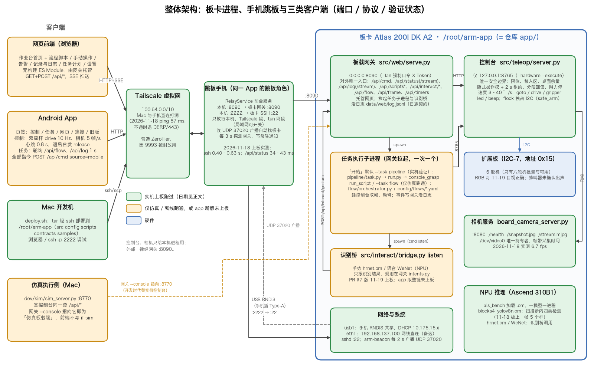

*图 1：板卡进程、跳板与客户端之间的连接、端口和协议。绿框表示上板跑过，橙框表示只在仿真或离线跑通，或者是 app 新版还没上板。*

本节的证据口径（按 AGENTS.md 区分三档）：

| 部分 | 实机实测 | 仅仿真 / 离线 | 只是文件存在 / 设计 |
|---|---|---|---|
| 相机服务、控制台 | 2026-11-18 经跳板起服务，相机 6.7 fps；当天经网关 `goto observe_v1` 回观察位（[31](../../current/31-板载端分离与中继通信.md) §2.1d） | — | — |
| 板载网关 + 手机跳板 | 2026-11-18 上板：`/api/status` 34–43 ms，`/api/frame` 60 ms；Mac 经 Tailscale → 跳板 → 板卡 SSH 0.40–0.63 s | 2026-11-18 App 跳板对仿真联调 | 网关当前版的 `/api/scripts*`、`run_script` 未上板 |
| 旧流水线（默认的「开始」） | 2026-11-19 板上多轮，最好一轮 4/4（[app/README](../../../app/README.md)）；夹空重试、就近、声光在 run `20261119_174751` 演示成功 | 仿真 seed 3、seed 5 各 4/4 | — |
| 分步编排器 + YAML 脚本 | **未上实机** | 2026-11-20 仿真跑通 `dance`、`gesture_sort`、`gripper_check`；离线回放 28 次实机扫描，152 块够得着的全部能规划抓取（[34](../../current/34-仓库结构与应用版本.md) §8） | — |
| 声光 | 2026-11-19：RGB 目视绿、黄、红、灭都正确；蜂鸣器调用成功，但没用耳朵确认出声（`records/hardware-tests/2026-11-19-feedback-rgb.json`） | — | app 版的 `/api/led`、`/api/beep` 移植后未上板 |
| 手势识别桥 | PR #7 版 2026-11-19 板上手势门 run `20261119_181226`：等 OK 7.4 s 后受理 | app 版 `bridge.py` → 网关 `/api/interact` 在仿真里走通 | app 版整条链未上板 |
| 网页前端 | 2026-11-18 起网关在板上托管页面，但没有对网页做系统的实机测试 | 2026-11-20 接仿真控制台逐页验证（[35](../../current/35-流程脚本与前端整理.md) §6） | — |
| 手机 App | 跳板角色 2026-11-18 上板；控制页 2026-11-18 用户在实机上试控过一次（[31](../../current/31-板载端分离与中继通信.md) §2.1d 17:47） | 任务页、10 Hz 摇杆延迟只在仿真里测过 | 横屏布局未做 |

> 板上那份代码和当前 `app/` 并不完全相同：2026-11-19 板上实际跑的是 PR #7 版（`integration/pr1-pr2` 加本地补丁）。11-20 并入 `app/` 后还没有重新部署，部署时跳板手机也离线，没能逐文件比对（[app/README](../../../app/README.md)）。下文说“上板”时都注明是哪一版。

## 地图迭代

桌面地图是一张 A4 横放的纸，上面印着 ArUco 定位码。它做三件事：给出桌面坐标系（每轮扫描用看到的码求地图在基座系里的位姿），作为采集训练数据时摆块的真值位置，在没有实体桶时充当投放目标位。地图由 `dev/tools/make_map.py` 生成，同时出可打印 PDF（`materials/maps/dofbot_map_a4_v*.pdf`）和码布局 JSON（`app/config/map_a4_v*.json`）。三版的约定相同：原点在纸的近边中点，X 朝机械臂右侧，Y 背离机械臂；近边贴紧底座平台前沿，虚线对准机械臂中心；必须按 100% 打印，并用纸上的 100 mm 校验尺核对。

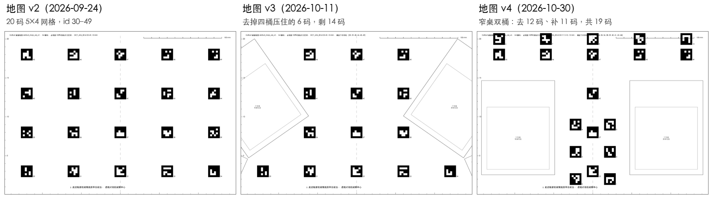

*v2 是满格；v3 为四桶方案去掉桶下的码，并印出桶的落位线；v4 是窄桌双桶方案，桶下的码全部去掉，在空出来的地方补码。*

### 版本一览

| 版本 | 日期 | 码数 | 码规格 | 布局 | 状态 |
|---|---|---|---|---|---|
| v1 | 2026-09-24 前 | 12 | 20 mm | 仓库里没有文件，只在 `docs/05` 留了一句话 | 已被 v2 替代 |
| v2 | 2026-09-24 设计，09-26 入库 | 20 | DICT_4X4_50，id 30–49，15 mm | 5 列（X = 0、±6、±12 cm）× 4 行（Y = 3、8、13、18 cm） | **实机长期使用** |
| v3 | 2026-10-11 入库（提交 cc63a9c） | 14 | 同 v2 | v2 去掉 6 枚码，印 2、3 号桶的落位线 | 只有设计，代码没切换过 |
| v4 | 2026-10-30 入库（提交 7278d2c） | 19 | 同 v2，另加 id 0–10 | 保留 v2 的 8 枚，补 11 枚，印双桶落位线 | 11-06 起实机使用（证据见第三节）；11-18 起 `board_up.sh` 默认 `ARM_MAP=map_a4_v4` |

### v1 → v2：加码，保证每个视角都能看到码（2026-09-24）

- **改的原因**：用相机模型做扫描模拟时，v1（12 枚 20 mm 码）在远排视角下最少只能看到 1 枚码。只有一枚码时，求平面位姿只能靠这枚码的 4 个角点，结果不稳（来源：`docs/05` 2026-09-24 20:10 一节）。
- **v2 设计**：20 枚码缩到 15 mm，排成 5 × 4 网格，列距 6 cm、行距 5 cm，码之间能放下 3 cm 物块；另印中线（在码的位置断开）、1 cm 刻度和 100 mm 比例尺。
- **v2 离线自检**：在接近相机分辨率下渲染，20/20 枚全部识别，布局残差 0.125 mm。按扫描模拟，远排每个视角能看到 2–4 枚完整的码，近排 1–2 枚；8 个视角合计覆盖地图的 81%。
- **v2 实机**：
  - 2026-09-24 打印上桌，第一次扫描每个视角看到 2–4 枚码，重投影误差 0.6–1.4 px。
  - 2026-09-25 做触点标定：让指尖依次触碰 5 枚码，求得地图原点在基座系 **(0.07, 6.75) cm**，桌面 z = −1.42 cm。残差均方根 2.8 mm，最大 4 mm；偏航 −0.8° 未应用。结果写进 `map_a4_v2.json` 的 `placement`，v3、v4 都沿用这组值。
  - 独立验证：取一个没参与拟合的姿态，把 41、42、46、47 号码的中心投回桌面，与标定结果平均差 1.4 mm，最大 2.2 mm。
- **v2 实机暴露的问题**：地图没粘在桌上，下探动作蹭到纸，两次扫描之间原点的 y 从 7.81 cm 漂到 8.68 cm，导致两块超出 28 cm 可达上限被跳过。从此要求固定地图，挪动后重做触点标定（`docs/05`、`12-实体容器选型约束.md`）。

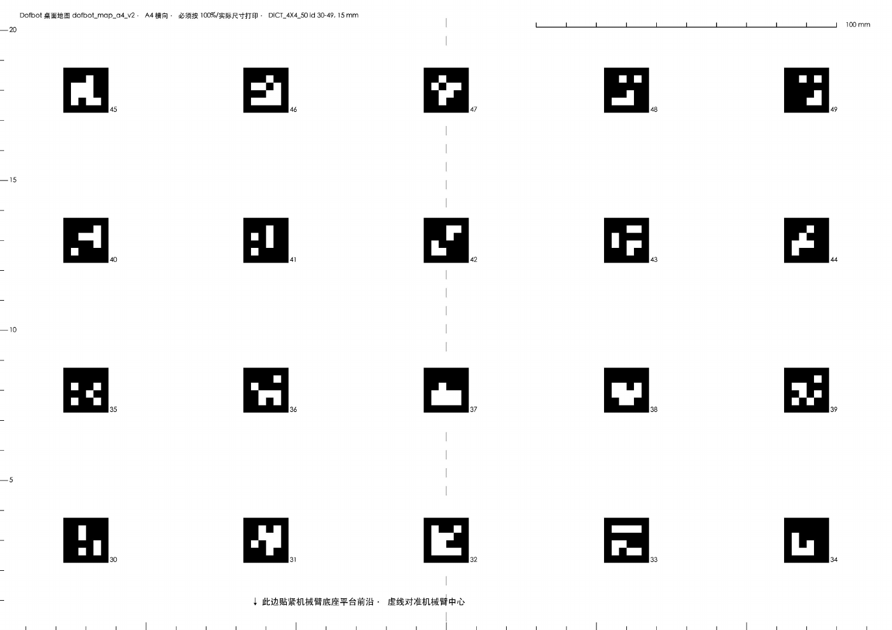

### v2 → v3：给四桶方案让位（2026-10-11，只有设计）

- **改的原因**：决定自制亚克力桶。四桶方案的桶放在两侧，中心离基座 22 cm，J1 分别为 24°/55°/125°/156°，2、3 号桶的底板会压住 v2 的一部分码。
- **改动**：去掉被 2、3 号桶压住的 6 枚码（35、39、40、44、45、49）。其余 14 枚的 id 和位置与 v2 完全一样，所以 v2 的触点标定可以直接沿用。纸上印出四个桶的底板和内口轮廓，作为落位线；1、4 号桶大部分在纸外，只印出一角。
- **状态**：`12-实体容器选型约束.md` 写明代码仍读 `map_a4_v2.json`，没有切换。仓库里没有 v3 打印或上桌的记录。2026-10-23 复核时发现 1–2、3–4 号桶的板边净距只有约 1.9 mm，摆放误差必须 ≤ 1 mm。这个问题后来随 v4 一起取消了。

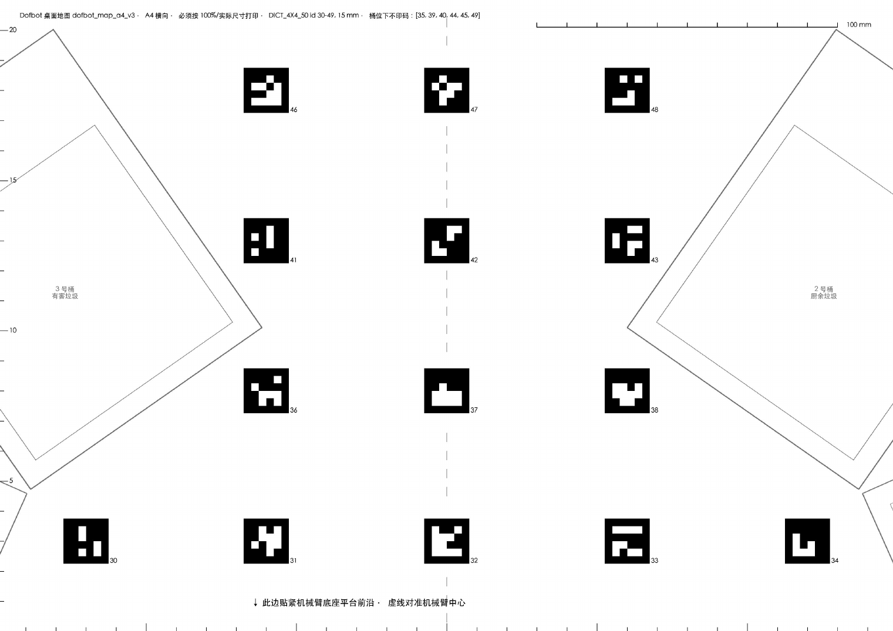

### v3 → v4：窄桌双桶（2026-10-30）

- **改的原因**：桌面只有 A4 长边那么宽（29.7 cm，|x| ≤ 14.85 cm）。四桶布局放不下：1、4 号桶的底板整块在桌外，2、3 号桶有一半悬空。于是先只做两类（厨余=2 号桶，有害=3 号桶），桶放在机械臂两侧前方（详见下一节）。
- **改动**（`map_a4_v4.json`）：
  - 去掉被两个桶压住的 12 枚码：30、31、33、34、35、36、38、39、40、41、43、44。
  - 保留 8 枚：中列 32、37、42（X = 0，Y = 3/8/13 cm）和远排 45–49（Y = 18 cm）。
  - 补 11 枚（id 0–10）：近区两桶之间 6 枚，在 X = ±2.2 cm、Y = 2/5.5/9 cm；远排外侧 5 枚，在 X = 0、±6、±12 cm、Y = 20 cm。
  - 共 19 枚。纸上印出两个桶的底板落位线：2 号桶在地图 x 4.73…14.13、y 2.55…14.65 cm；3 号桶左右对称。
- **注册的配套改动**：地图注册在没有视角能看到 3 枚码时，退到用 2 枚（24 号文档 §5）。v4 和 v2 共有的码（含 42、47）位置相同，两张地图可以互相核对（31 号文档）。
- **待办**：v4 的摆放标定值仍沿用 v2 的触点标定。24 号文档的清单要求“v4 贴法若与 v2 不同就重做触点标定”，仓库里没有找到 v4 单独做触点标定的记录。
- **观察**（渲染 PDF 时看到）：v4 页眉文字和 100 mm 比例尺压在 Y = 20 cm 那排码（6–10）上。这是否影响识别没有测过。

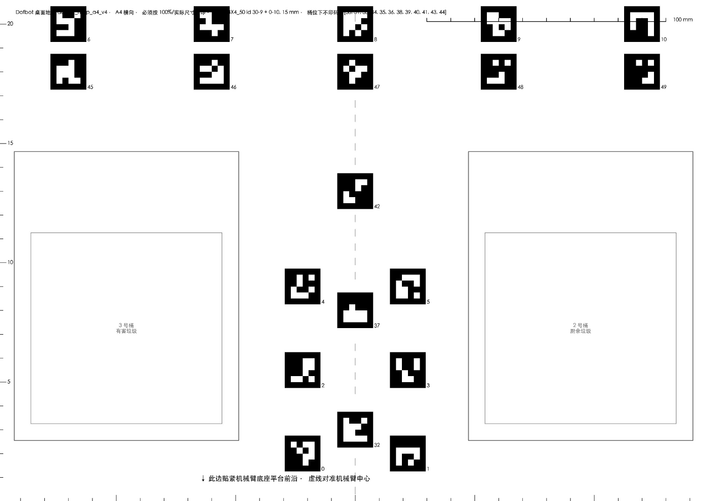

## 垃圾桶建模与亚克力图纸

### 选型约束（2026-10-08，依据实测）

`12-实体容器选型约束.md` 先给出约束，再开始设计：

| 约束 | 数值 | 依据 |
|---|---|---|
| 开口内径 | ≥ 8 cm | 物块 3 cm；投放落点离目标中心实测 0.2–0.8 cm，修复前最差 2.2 cm |
| 壁高 | ≤ 4 cm（建议） | 低壁或透明壁，扫描时才能看到块是否落进去；纯几何上限约 6 cm |
| 中心离基座 | 18–24 cm | 可达环带 13–28 cm，两端各留余量 |
| 相邻中心距 | ≥ 开口 + 2 cm | 投放时夹爪不碰邻桶 |
| 其他 | 固定牢靠、轻、颜色避开红/绿/蓝/黄 | 地图被蹭移 0.9 cm 就导致两块够不到 |

最后选了**自制 2 mm 透明亚克力**：透明壁保留俯视核对，还能在上面贴定位码。

### 结构：插板式方桶（图号 BIN-ACR-01，设计值）

由 `dev/tools/make_bins.py`（几何在 `bins_core.py`，出图在 `bins_fab.py`）一次生成配置、6 页 A3 图纸、两个 DXF 和贴纸。参数见 `materials/bins/README.md` §2 和 `app/config/bins_acrylic_v1.json`：

| 项目 | 数值 |
|---|---|
| 板厚 t | 2.0 mm（主耦合尺寸：侧板长 = 80 + t，侧板总高 = 40 + t，插舌高 = t，槽宽默认 = t） |
| 内口 / 外廓 | 80 × 80 / 84 × 84 mm |
| 壁高 / 总高 | 40 / 42 mm |
| 底板 | 94 × 121 × 2 mm，三边留 5 mm，耳板一侧留 32 mm；开 8 个 14 × 2 mm 通槽，四角每两条槽合并成一个 L 形孔 |
| 侧板 | 82 × 42 × 2 mm，每桶 4 块且完全相同；两端各一个 14 × 2 mm 插舌，中间底边上移 2 mm（缺口 54 mm） |
| 拼接 | 插舌对槽竖直插到底，与底板下表面平齐；按近边 A → 右 B → 远边 C → 左 D 的顺序插；槽口、插舌和四角涂亚克力溶剂胶，室温固化 24 h |
| 用料 | 一套 4 桶 = 4 块底板 + 16 块侧板；排版外包围 297 × 388 mm，即最小料板，利用率 85.0%（用 300 × 400 标准板为 81.6%） |
| 重量 | 单桶约 58 g，一套约 233 g（PMMA 按 1.19 g/cm³ 估算） |
| DXF | `bins_acrylic_v1_cut.dxf` 只有 `CUT` 层，36 条闭合多义线（4 底板 + 16 个 L 形孔 + 16 侧板）；另有单件版 `_cut_parts.dxf` |

**设计变更**（README §11）：

- 2026-10-09：首版设计稿，3 页 A3。
- 2026-10-23 版本 A：先做了“底板 + 风车四壁 + 可选浅雕”，同一天改成插板式，取消浅雕层。
- 2026-10-30 版本 B（`bins_acrylic_v2_pair.json`）：只为双桶重出贴纸和配置，几何不变，已切好的板不重切。

**松紧可以单独调**：只改槽宽用 `--slot-mm 1.9/2.1`；板厚实测不是 2.0 mm 时，用 `--thickness-mm` 全部重算，不能手工改单个尺寸。

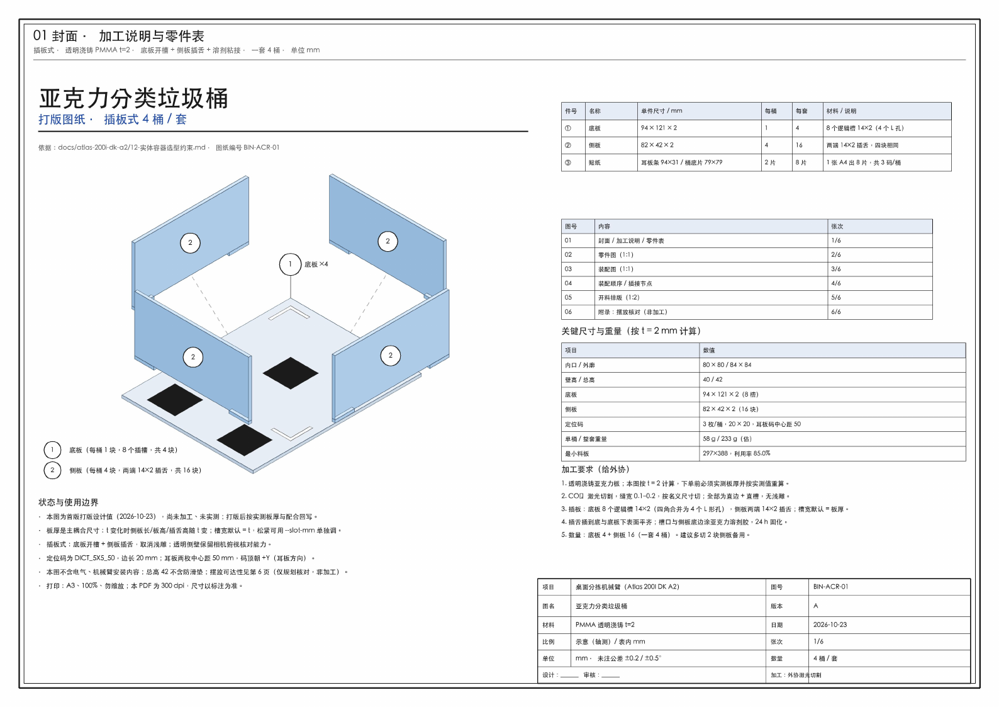

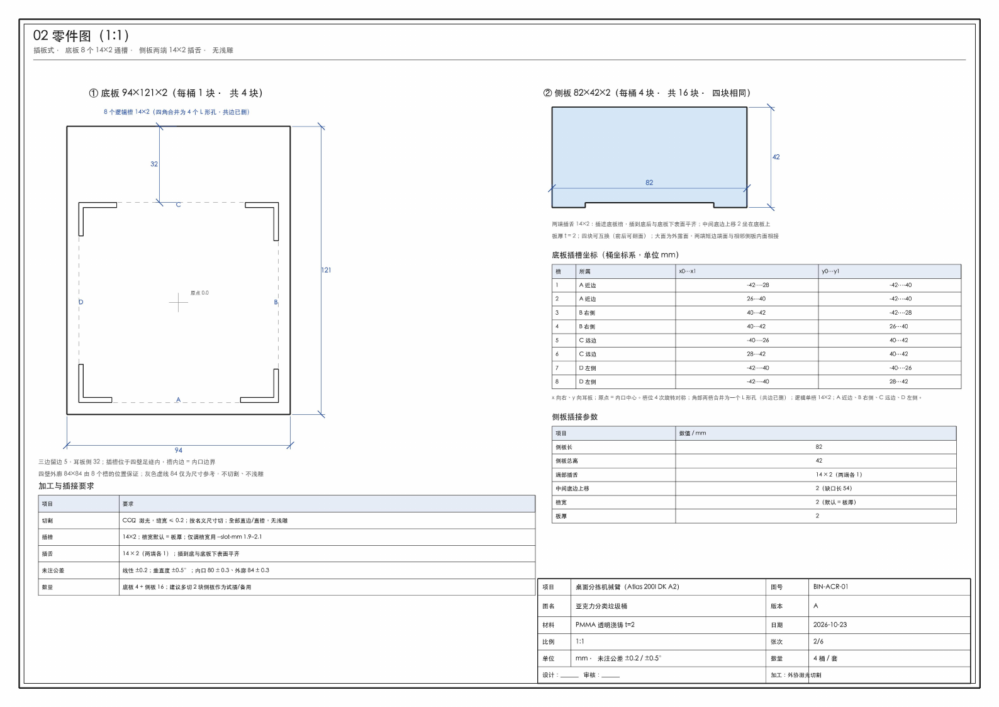

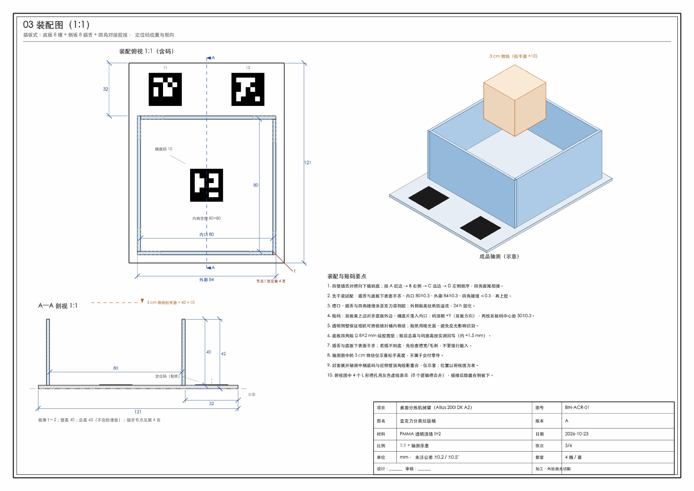

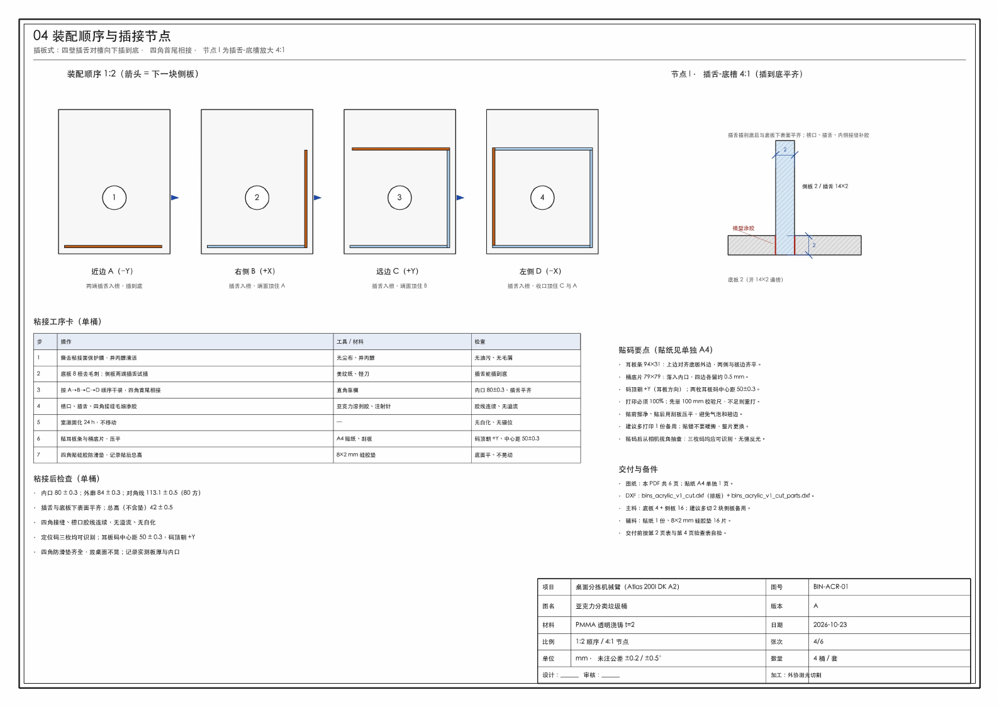

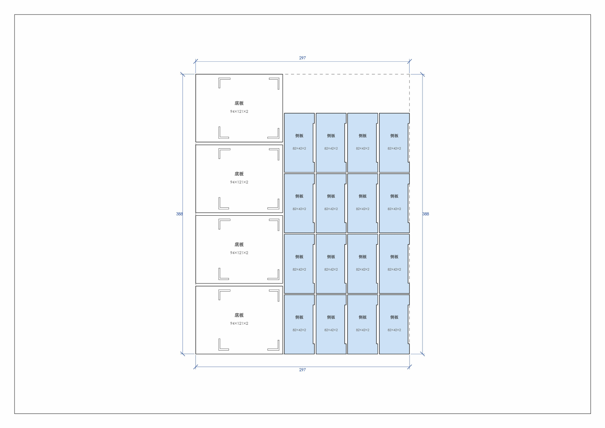

### 贴纸定位

- 桶上的码用 **DICT_5X5_50**，边长 20 mm。地图和桌面基准用的是 4X4，两类码不会混淆。
- 每桶 3 枚码：
  - 桶底 1 枚，id 10n，位于内口中心，离内壁 30 mm。这枚码被块盖住，就说明桶里有东西。
  - 耳板 2 枚，id 10n+1 和 10n+2，中心距 50 mm，离外边 6 mm、离壁 6 mm、离侧边 12 mm，码顶朝 +Y（耳板方向）。
  - 2 号桶用 20/21/22，3 号桶用 30/31/32。
- 码面高度按板厚 + 纸厚记为 2.1 mm（`marker_plane_above_table_m: 0.0021`），要实测后回写。
- 贴纸为 A4 哑光不干胶，100% 打印：耳板条 94 × 31 mm，上边对齐底板外边；桶底片 79 × 79 mm，落进 80 mm 内口。
- 软件自检：把图缩到相机分辨率后，12/12 枚码都能检出；耳板码中心距换算为 49.92–50.09 mm（设计 50 mm）。这是生成图上的软件量测，不是实物测量。

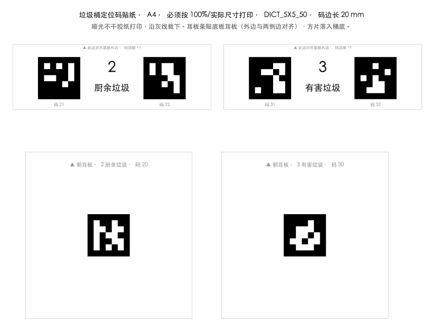

### 四桶 → 窄桌双桶

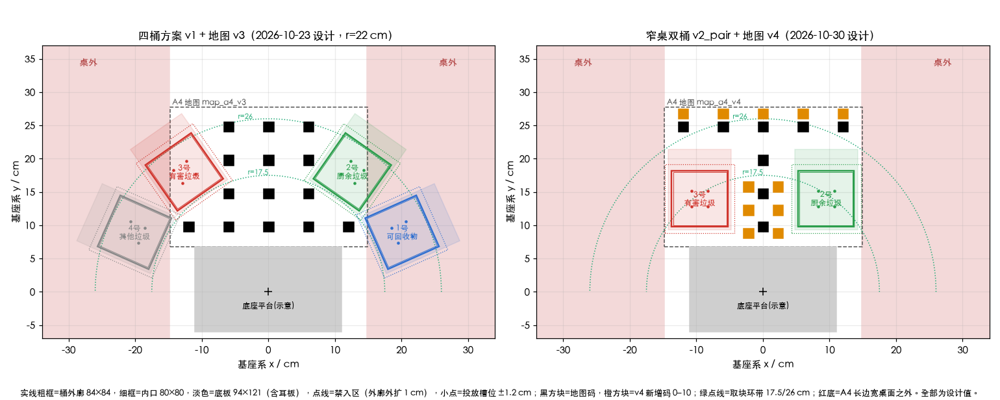

*按 `bins_acrylic_v1.json` + `map_a4_v3.json`、`bins_acrylic_v2_pair.json` + `map_a4_v4.json` 画出，全部是设计值。*

- **四桶方案**（2026-10-23，设计值）：r = 22 cm，J1 = 24°/55°/125°/156°，耳板朝外，指尖在 z 5.0 cm、俯角 145° 时松手点有解。放在桌上后，1、4 号桶整块在桌外，2、3 号桶一半悬空（见上图左），1–2、3–4 号桶板边净距约 1.9 mm。
- **双桶方案**（2026-10-30，`dev/tools/layout_bins.py` 在桌面范围内搜索）：
  - 搜索条件：底板留在桌上，离平台前沿 ≥ 1 cm；每个投放槽位都够得着；取块区尽量大。
  - 结果：中心 **(±9.5, 14.0) cm**（基座系），耳板朝后（+Y）。两块底板相隔 9.6 cm，离平台前沿 2.6 cm。
  - 选这里的原因：离基座 < 17.5 cm 的近区机械臂本来就取不了块，桶放在这里几乎不占取块区。代价是取块位从空桌时的 10 个（约 158 cm²）减到约 4 个（约 56 cm²）。
  - 坏处：桶离得太近，相机在正常限位内看不到桶上的码，所以双桶**不靠相机找桶**，按地图 v4 的落位线摆放，管线直接用设计位置。
- **观察位姿**：`bin_views_bins_acrylic_v1.json` 给四桶每桶找了一个专用观察位姿（J2 = 80、J3 = 30，余量 3.3 cm）。双桶的 `..._v2_pair_relaxed.json` 要用到 J4 = −10、余量只有 2.2 cm，没有程序读它，只留给实机手动试。两份都是用相机模型搜出来的，没有上实机。

### 桶口投放与禁入区建模

- **桶口投放**（`console_grasp.plan_put/put` 的 `drop_tip_z`）：指尖停在桶口上方直接松手，不再下放。指尖高度 = 台面 + 桶沿 4.2 + 夹取高度 1.2 + 余量 1.5 = **5.48 cm**（基座系）。11-06 实机日志里 `put_planned.drop_tip_z_cm` 正是 5.48。
- **投放槽位**：每桶 4 个，在桶系的 (±1.2, ±1.2) cm，按顺序用。每桶容量 4 块，计数存在 `data/runs/bins_state.json`，装满记 `bin_full` 后跳过该类；`--empty-bins` 清零。
- **桶禁入区**：四壁加底板作为障碍，手指离桶壁不足 1 cm 的路径直接拒绝（`PathBlocked`）。扫描时被挡的近视角跳过（记 `scan_view_skipped`）；回观察位被挡，就先抬高再绕过去。
- **桶定位**（四桶方案用）：同一块板上的 5×5 码合在一起做平面 PnP，经正运动学和手眼标定换到基座系，再融合多个视角。仿真里无偏差时误差 ≤ 0.1 mm，关节偏差 1.5° 时约 6.5 mm；精度上限就是相机位姿的精度。
- **半侧启动**：`--bin-side left|right`，只立选中的那个桶，`right` = 2 号、`left` = 3 号。

### 仿真结果（2026-10-30，Mac，`dev/sim`，只说明几何与接口能对上）

| 条件 | 结果 |
|---|---|
| 原四桶、规划位置、4 块 | 3 块入桶，1 块挂在桶沿（槽位 ±1.8） |
| 双桶，桶偏差 8 mm/4°，关节偏差 1.5°，槽位 **±1.2** | 8/8 入对桶，0 次蹭桶（两次独立重复） |
| 同上，槽位 ±1.8 | 第一轮 4 块里 2 块挂沿 |
| 同上，槽位 ±0.6 | 第二轮 8 块里 1 块没入桶 |
| 4 轮累积，桶偏差 3 mm/2° | 前两轮 8/8，后两轮桶满，8 次 `bin_full`，0 次蹭桶 |
| 未加禁入区 | 扫描近视角和补拍路径的手指擦过桶沿（离壁 2 mm 内） |

据此把槽位定为 ±1.2 cm，写进 `app/config/sorting.json`。

2026-11-20 还做了一次随机布局对比（`dev/sim/compare_sort.py`，地图 v4 + 双桶，10 个布局，每轮 4 块，其中 2 块有对应的桶）：新分步流程 8/20 投对桶、碰桶 5 次；旧流水线 9/20 投对桶、碰桶 3 次、碰块 2 次。主要原因是块常被随机放在离桶壁 2–3 cm 以内（34 号文档）。以上都是仿真。

## 垃圾桶实机测试

**证据来源**：

- 仓库内的正式记录：`docs/current/24-垃圾桶建模与仿真联调.md` §9、§9.1，`app/config/sorting.json` 的 `_drop_offset_note`，`records/hardware-tests/2026-11-19-demo-and-tuning.json`。
- 不在仓库里的本地日志和照片：`data/runs/console_grasp/log.jsonl`、`data/runs/pipeline/20261106_*`、`data/runs/console_grasp/drops/`。`data/` 按约定不入库，下文凡引用都单独注明。

**桶的制作**：24 号文档写明，2026-10-30 时“亚克力板已到手”；11-06 的腕部相机照片里，两个透明方桶贴着 2 号厨余、3 号有害的耳板条。由此可以确认桶已经加工并摆上桌。但 README §5 要求的板厚卡尺测量、验收表（内口、外廓、总高、码面高度）**在仓库里都没有记录**，两个桶的配置 `_status` 仍是 “not cut, not measured”，所以桶的尺寸只能按设计值看待。

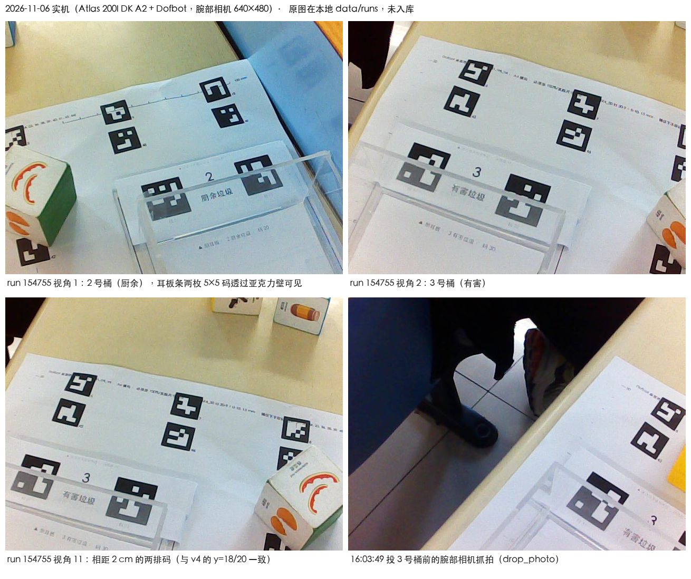

### 2026-11-06 第一次上手：空夹爪核对（实机，桌上没有桶）

- **条件**：Atlas 200I DK A2 + Dofbot，Mac 经 SSH 连板；板上操作台 `--hardware --execute`；控制台在 `normal` 档。桌上没有桶也没有块，用户站在机械臂旁，每次动作前亲自输入 `y`。
- **工具**：`app/src/tasks/bin_checkout.py`。`plan` 不动臂；`hover` 带着空夹爪走到桶口上方停住，再退回。

| 项目 | 结果 |
|---|---|
| `plan` | 两个桶各 4 个槽位在投放高度都够得着 |
| `hover --bin 2 --slot 0` | 回读 `[59,97,15,7,122]`，指尖 (8.3, 13.8, **5.1**) cm，要求 z 5.5 cm，低 0.4 cm；去和回都没有偏差报警 |
| `hover --bin 3 --slot 0` | 第一次被拒：`servo 5: target 92 outside soft limit [95, 180]`（`normal` 档）。改用 J5 = 95 后通过，回读 `[129,88,25,7,95]`，指尖 (−11.1, 13.7, 5.5) cm，要求 (−11.3, 13.6, 5.5) cm |
| 用户目视 | 夹爪基本在落点正上方；离桌面偏高，块落下时可能弹 |
| 后续修复 | 11-13 提交 5fb7943：`hover` 新增 `--j5`，按当前档位允许的手腕角度核对 |

### 2026-11-06 真实分拣进桶（实机，桶已摆上）

- **条件**：桶按设计位置摆放，没有用相机找桶（日志里 `bins_located.source = planned`）。控制台在 `explore` 档。命令为 `run.py --bins bins_acrylic_v2_pair`，一次分拣一块。桌上有绿、红、蓝、黄等若干块。
- **地图**：照片里能看到相距 2 cm 的两排码，与 v4 的 Y = 18/20 cm 两排一致，所以桌上应该是 v4 打印件。但日志只记下了 42、45–49 号码（v2 和 v4 共有），**记录里没有写明这几轮用的是哪个地图配置**。

24 号文档 §9.1 只正式记录了第一块。本地日志里同一下午共有 5 轮 `pipeline_start`，汇总如下（第 1 行同时有正式文档，其余只在本地日志）：

| 时间（run） | 块（地图 cm） | 类别（检测票数/视角） | 结果 | 落点（地图 cm） | 用时 |
|---|---|---|---|---|---|
| 15:49（154755） | 绿 (0.6, 15.1) | 厨余 7.31 / 10 视角 | **进 2 号桶**，槽位 0；夹取读回 128，抬起后仍为 128 | (8.39, 5.91)，俯角 150，J5 125 | 23 s |
| 15:53（155229） | (0.2, 14.3) | 有害 7.4 / 8 视角 | **进 3 号桶**，槽位 0；读回 129 | (−10.75, 5.86)，俯角 150，J5 92 | 19 s |
| 16:01（160044） | (−0.8, 17.2) | 有害 | 夹空（读回 131），张开后抬起 | — | 14 s |
| 16:03（160241） | (−3.2, 18.2) | 有害 6.55 / 7 视角 | **进 3 号桶**，槽位 0（计数此前已清零）；松手前抓拍了一张 drop_photo | (−10.94, 6.17)，俯角 145，J5 92 | 22 s |
| 16:05（160502） | — | — | 0 块分拣，9 块跳过 | — | 5 s |

合计 3 块进了对应的桶（厨余 1、有害 2），夹空 1 次，没有投错桶的记录。最终 `bins_state.json` = `{"2": 0, "3": 1}`，与 16:03 前清零一次的顺序一致。

**正式记录里的现象**：

- 扫描：8 个视角走了 6 个，`[50,105,5,0]` 和 `[125,105,5,0]` 离桶壁不足 1 cm，被禁入区跳过，和仿真预测一致。地图注册用了 10 个视角，原点 (−0.09, 6.89, −1.31) cm，与触点标定的 y 差 1.4 mm。
- 落点：块落下后**会弹，最后停在靠近桶边的位置**。`sorting.json` 记的是：2 号桶的块偏向桶边；3 号桶的块弹到靠近左边，偏差约 1–2 cm。为此在 `drop_offset_cm` 里留了按桶的修正项，目前两个桶都还是 0，没有填实测值。
- 原因：松手时指尖在 5.5 cm，块底离桶底约 4 cm，相当于自由落体。在改成“下探到更低再松手”之前，“每桶装 4 块”的假设没有验证，**先按每桶 2 块用**。
- 计数：桶底的白色贴纸会被扫描当成桶里有块（本地日志里桶空时也出现 `bin_count_differs ... seen 1`），所以桶内块数以 `bins_state.json` 的记录为准。
- 保护：离基座 < 17.5 cm 的块被跳过（红块在 16.5 cm）；没有对应桶的类别（黄块）被跳过；桶边的蓝块被判为“已在桶里”，没有去碰。
- 安全：J5 = 92 低于 `normal` 档软限位 95，所以这几轮用的是 `explore` 档。这个限位冲突**还没有从规划上解决**。

### 2026-11-18：板上新流程扫描（实机，桌上没有桶）

用户确认桌上没有桶，只跑了扫描和解算验证，不算桶测试。扫描前离线核对发现：新分步流程的扫描不检查桶；双桶在设计位时，扫描视角 5、7 及两者之间的路线会**进入桶禁入区 0.7 cm**。结论是桌上有桶时，新流程扫描在修好之前不能上实机（31 号文档）。

### 2026-11-19：中期演示调参（实机，记录在 `2026-11-19-demo-and-tuning.json`）

- run `20261119_174751`：操作员在第二块下降时把块拨开 2.2 cm，造成真实夹空。随后依次出现黄灯 + 蜂鸣、退回重扫、在离原坐标 2.2 cm 处找回、再次抓住、绿灯 + 短鸣，最后**进 2 号桶**。
- run `20261119_174041`：夹空后退回（back_off）的路径擦到桶禁入区 0.2–0.4 cm，被拒，整轮当场中断。已修：先抬 2 cm 再退回，退回失败也不再中断整轮。
- 这份 JSON 没有记录桶的摆放位置、落点偏差、桶里实际有几块，只有“进 2 号桶”的一句结论。

### 现状小结

| 项目 | 状态 |
|---|---|
| 桶已加工、摆上桌 | 有照片（本地 11-06），没有尺寸验收记录 |
| 空夹爪桶口核对 | **实机**（11-06）：两桶槽位 0 都到位；2 号桶指尖低 0.4 cm；3 号桶 J5 与 `normal` 档冲突 |
| 真实块进桶 | **实机**（11-06）：3 块进对的桶，1 次夹空，0 次投错（只有第 1 块写进正式文档）；11-19 演示有 1 次进 2 号桶 |
| 落点精度 | 实机只有定性结论（弹动，偏向桶边约 1–2 cm），没有逐块测量 |
| 每桶容量 4 块 | 仿真通过；实机未验证，先按 2 块用 |
| 相机找桶 | 双桶不用；四桶的观察位姿只在仿真里搜过 |
| v4 地图触点标定 | 沿用 v2 的标定值，没有 v4 的单独记录 |

> 本节状态标注：**【实机】**＝在 Atlas 200I DK A2 或机械臂上实测，附日期与证据；**【离线】**＝Mac 上用真实采集数据重放计算；**【仿真】**＝合成渲染或纯几何模拟；**【文件】**＝只确认文件存在或规格。数字均摘自仓库文件，出处写在括号里。

## YOLO 检测模型训练

### 1. 为什么自己训练

- 课程物块是 4 个约 3 cm 的木质立方体，每块一对纯色对面，其余 4 个侧面各贴一张同类垃圾贴纸，共 16 种贴纸（`docs/current/07`）。颜色与大类一一对应：黄＝其他、蓝＝可回收、绿＝厨余、红＝有害。
- 官方 `yolov5s_bs1.om` 只有 `Fish_bone / Newspaper / Syringe` 3 类，没有“其他”类。2026-09-26 板上实测时，它常与颜色给出的结论矛盾，绿块和蓝块都被判成注射器（0.66–0.68），因此**只作对照，不参与判定**（docs/05 2026-09-26 13:30）。
- 课程旧模型输出 Blue/Green/Red/Yellow 四个颜色标签，不能直接当垃圾类别。另外，贴纸面朝上时白贴纸压在白纸上，旧的“轮廓＋前景差分”找不到物块。
- 决定：训练一个 **4 类检测器，类别直接是垃圾大类** `recyclable / kitchen / hazardous / other`。一块物块不论哪面朝上，都属同一类。

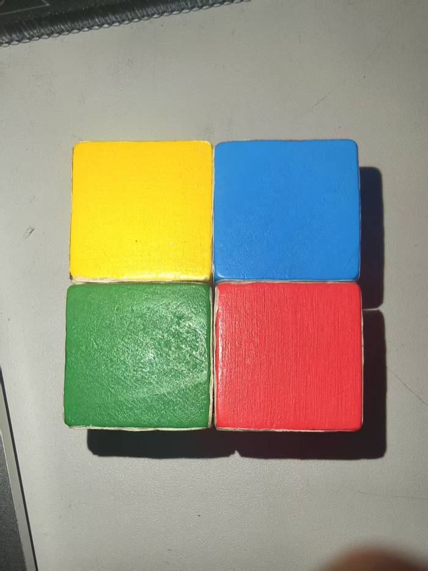

*图：四块物块的纯色面（2026-09-24 拍摄，`docs/images/03`）。另外 4 个侧面各贴一张同类贴纸。*

### 2. 数据采集：标签来自摆放，不来自识别　【实机采集】

- 流程（`dev/pipeline/collect.py --plan-placement / --placed`）：
  1. 脚本随机指派 4 个地图码，操作员把对应物块放上去，朝上面和角度随意。
  2. 机械臂多视角扫描。
  3. 按码中心在正射图上把真实轮廓对齐（`cubes.refine_at`，20 mm 窗口，每偏 1 mm 扣 0.01 分，以免被阴影和侧面拉走）。
  4. 用相机模型把 3 cm 立方体的 **8 个角投影到 8 个视角**，取外接框，生成 YOLO 标签。
- **检测器不参与标注**，避免模型强化自己的偏见。
- 规模（`data/datasets/blocks4/20260925_195121/`）：**21 轮**（15 轮手摆＋6 轮颜色面朝上），**160 张图、281 个框**，四类基本均衡。
- 质量控制：采集中出过 3 次人为失误，分别是没挪块（第 11 轮）、红蓝放反（第 15 轮）、放到相邻码（第 19 轮）。三次都按正射图核对后改正，并新增 `dev/vision/check_round.py`，用模型在 8 个视角上对照标注，自动报出放错的轮次。
- 机械臂自动翻面试过两次，都失败（倾斜 48°–65° 松手后落回原面），改为人工翻面（docs/05）。

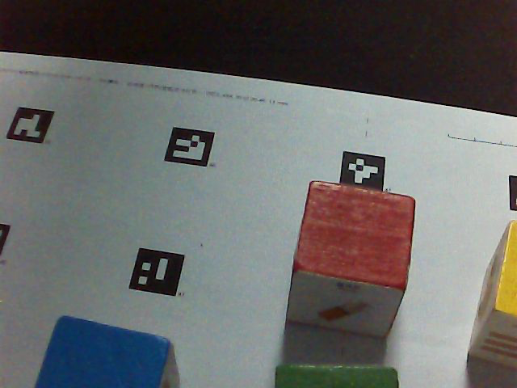

*图：一轮采集中的一个腕部视角。ArUco 地图码同时给出桌面坐标系和每块的真值位置。*

### 3. 合成数据　【离线生成】

- 脚本 `dev/vision/synth_blocks.py`：拍下 20 张面纹理（4 个颜色面＋16 张贴纸，第 6 面用物块本色），当作 30 mm 立方体渲染进**真实扫描画面**。渲染用该视角已标定的相机位姿，所以能放在地图任意位置、任意朝向、任意面朝上，框精确已知。
- 模拟项：
  - 透视：每个可见面做一次单应变换。
  - 光照：每帧一个光向，朗伯着色，再按周围纸面亮度缩放（板载相机曝光随姿态变化）。
  - 接触阴影：底面沿光向投影后模糊。
  - 其他：圆角、轻微模糊和传感器噪声。
- 两条硬约束：
  1. 只在该视角**看得到**的地图点上放置。
  2. 合成块**不得遮挡**画面里的真实块，否则真实标注会变成错标。
- 防泄漏：验证轮次的画面不作为合成背景。
- 规模（`data/datasets/blocks4/synth_v1/`）：**800 帧、3 138 个框**。

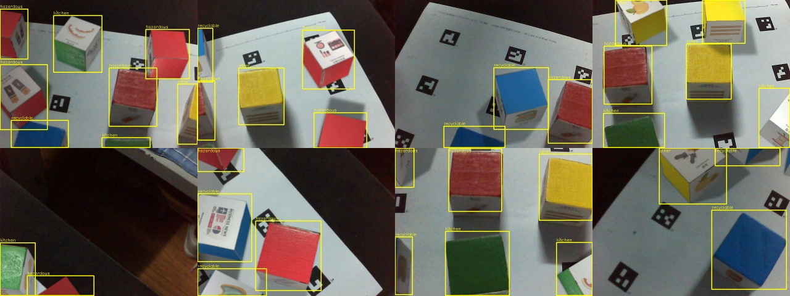

*图：合成样本。立方体渲染进真实扫描画面，黄框为自动生成的标注。*

### 4. 训练设置　【离线】

| 项 | 值（`dev/vision/train_blocks.py`，`data/models/blocks4/v3/train.log`） |
|---|---|
| 网络 | Ultralytics YOLOv8n，`yolov8n.pt` 预训练；融合后 72 层、3,006,428 参数、8.1 GFLOPs |
| 输入 | 640×640，batch 16，seed 0，早停 patience = max(20, epochs/4) |
| 设备 | Mac（Apple M4）MPS；v3 的 60 轮共 3 016 s（约 50 min，`results.csv` 的 time 列） |
| 增强 | `hsv_h=0.005, hsv_s=0.4, hsv_v=0.4, degrees=10, translate=0.1, scale=0.3, fliplr=0.5, mosaic=1.0`。色调扰动压得很小，因为颜色本身就是类别线索 |
| 划分 | **按整轮留出**：同一轮的 8 个视角拍的是同一摆放，高度相关，按帧随机切会让指标虚高。v2/v3 留出 `round_004 / 017 / 021`，共 **24 张图、42 个框**；训练集为 136 张真实图（v3 另加 800 张合成，共 936 张） |
| 导出 | ONNX opset 12，simplify，静态 `1×3×640×640`，输出 `[1, 8, 8400]`（4 个框坐标＋4 个类别得分，无 objectness） |

### 5. 指标　【离线】

| 版本 | 训练数据 / 轮数 | mAP@0.5 | mAP@0.5:0.95 | 可回收 | 厨余 | 有害 | 其他 |
|---|---|---|---|---|---|---|---|
| v1 | 136 真实 / 60 轮 | 0.918 | 0.667 | 0.887 | 0.921 | 0.939 | 0.927 |
| v2 | 136 真实 / 100 轮 | 0.932 | 0.741 | 0.988 | 0.995 | 0.916 | 0.829 |
| **v3（在用）** | **136 真实＋800 合成 / 60 轮** | **0.952** | **0.757** | 0.995 | 0.995 | 0.946 | 0.870 |
| v3＋仅真实微调 | 再微调 40 轮，lr0 = 0.001 | 0.877 | 0.700 | 0.995 | 0.922 | 0.872 | 0.718 |

（出处：`data/models/blocks4/v{1,2,3}/summary.json`、`v3/train.log`。v1 的留出轮次是 004/007/011，与 v2/v3 不同，不能严格横比。）

- 合成数据带来 mAP@0.5 **+2.0 个点**（0.932 → 0.952），mAP@0.5:0.95 +1.6 个点。
- “先混合、再只用真实数据微调”反而变差，“其他”类从 0.87 掉到 0.72。原因是 136 张真实图撑不起 40 轮微调。这次尝试已记录并放弃，v3 采用混合训练那一版。
- “其他”类最弱（0.870），它的贴纸（筷子、烟蒂、卫生纸、桃核）多为白底、弱纹理。

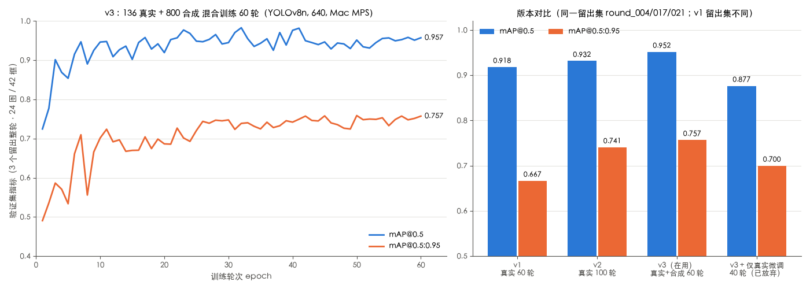

*图：左为 v3 混合训练 60 轮在留出集上的 mAP 曲线（`train_runs/blocks4/results.csv`，逐轮与 `v3/train.log` 核对一致）；右为各版本最终指标。*

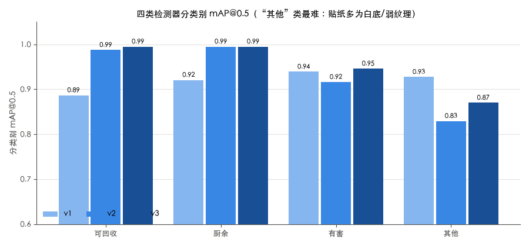

**比检测指标更重要的是整条流程的评分**（`dev/pipeline/eval_scene.py`，15 轮手摆的 60 块，真值来自摆放；`data/models/blocks4/v3/eval_scene.json`）：

| 项 | v3 结果 |
|---|---|
| 找到 / 类别正确 / 判错 / 多报 | **60/60 / 60/60 / 0 / 0** |
| 中心误差 | 中位 0.0 cm、p90 1.04 cm、最大 1.55 cm |
| 朝向误差 | 中位 0°、最大 36° |
| 按抓取容差（中心 ≤ 1 cm 且朝向 ≤ 12°）可直接抓 | 50/60（83.3%）；v2 为 49/60 |

### 6. 转 OM 上板　【离线转换 + 实机验证】

- 不在板上转换：2026-09-26 曾在板上运行 `atc`，4 GB 内存被占满，SSH 失去响应，只能断电重启。
- 改为把板上的 CANN 6.2.RC1 aarch64 工具包拷到 Mac，在同版本 Ubuntu 22.04 arm64 容器里转换（`dev/scripts/convert_om.sh`）：

```sh
atc --model=best.onnx --framework=5 --output=blocks4_yolov8n \
    --input_format=NCHW --input_shape="images:1,3,640,640" --soc_version=Ascend310B1 --log=error
```

- 耗时 **20 s**，产物 `blocks4_yolov8n.om` **7.1 MB**（7,109,231 B）。注意 `soc_version` 只认 `Ascend310B1`，不是 `Ascend310B4`。
- `atc` 报的 `EZ3002: Optype [Conv2D] ... unsupported` 与真实原因无关。用一个只含单个 `Conv` 的极小 ONNX 做对照，确认是环境问题，再逐个排查出 4 个坑：
  1. 缺 `libascend_hal.so`：改用工具包自带的 devlib 替身库。
  2. 缺 `libxml2`：镜像里加装。
  3. **容器是 Python 3.10**，TBE 代码里的 `from collections import Iterable` 已失效：改用 3.9，与板上一致。
  4. **numpy 2.x 移除了 `np.float_`**：固定 `numpy<2`。
- 板上验证（2026-09-27 00:05–00:20，**【实机】**，机械臂未动作；证据 `data/archive/stage1-research/checks/om_vs_onnx/`）：
  - NPU 推理 **12.9 ms/帧**（`--bench 50`）。同一模型在 Mac 上用 ONNX 跑是 16.1 ms。
  - 与 ONNX 对照：类别与置信度相差 ≤ 0.001，检测框相差 ≤ 1 px。
  - 原始张量 `[1,8,8400]`：30 个置信度 > 0.25 的锚点上，框坐标最大差 **0.37 px**（中位 0.08），类别得分最大差 **0.0076**，类别判定 **100% 一致**。全部锚点中的最大差 3.47 px 来自低置信度噪声锚点，符合 fp16 的预期。
  - 板上跑 `eval_scene`（120 张图，1 分 56 秒），结果与 Mac **完全相同**（60/60 找到、60/60 正确、50/60 可直接抓）。
- 同日 00:15，第一次**完全在板上**完成自动分拣（`data/runs/pipeline/20260927_001504`）：4 块贴纸面朝上，类别全部来自 v3 OM，四块全部分拣正确并一次夹住，全程约 3 分 43 秒（docs/05）。
- 2026-10-16 三模型共驻测试（**【实机】**，`records/hardware-tests/2026-10-16-npu-concurrency.json`）：检测器单独运行中位 **12.80 ms**；与语音、手势模型并发（每线程自建 session）时为 **32.2 ms**，仍有约 31 fps 的能力，而腕部相机只有约 7.6 fps。

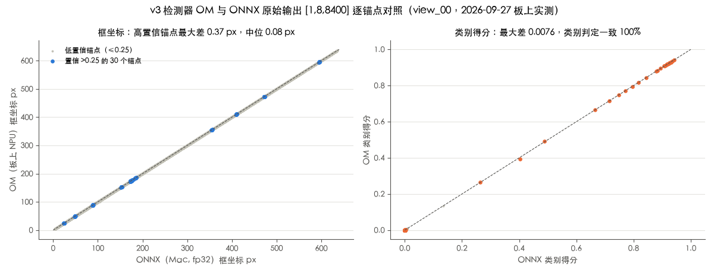

*图：用 `data/archive/stage1-research/checks/om_vs_onnx/{om,onnx}_raw_view_00.npy` 重画。点几乎全部落在对角线上，说明 fp16 量化没有改变检测结果。*

- 顺带修了一个隐患：`.om` 放进模型目录后，Mac 上会优先选它，而 Mac 没有 `ais_bench`，流水线会**静默丢掉检测器**、退回只按颜色分类。改为 `choose_model`：没有 `ais_bench` 时自动回退到 ONNX（docs/05 2026-09-26 23:30）。
- 后续还发现一个差异：板（cv2 4.10）与 Mac（cv2 5.0）对同一扫描的**地图注册**不同，两块的朝向相差 6–9°。检测结果本身两边一致。结论是以板上结果为准。

---

## 从检测到物块中心与朝向

YOLO 只回答“框里有一块什么类别的物块”。抓取需要的是物块在**桌面坐标系**里的 (x, y, yaw)。中心误差要在约 1 cm 以内，朝向误差要在 12° 以内。本项目不训练位姿模型，而是用三条已知几何来算：地图码坐标系、已标定的相机位姿、**物块是 3 cm 立方体**。

### 1. 地图码坐标系与相机位姿　【实机标定】

- 地图是一张 A4 纸（`dev/tools/make_map.py` 生成）。v2 版有 20 个 ArUco 码（DICT_4X4_50，id 30–49，边长 15 mm），排成 5 列（X = 0、±6、±12 cm）× 4 行（Y = 3、8、13、18 cm）。自检 20/20 识别，布局残差 0.125 mm。
- 坐标系：X 指向机械臂右侧，Y 远离机械臂，Z 向上，原点在纸的近边中点。当前双桶布局改用 `map_a4_v4`（`ARM_MAP=map_a4_v4`）。
- 每次扫描先做**地图注册**（`app/src/pipeline/scene.py`）：
  1. 每个看到 ≥ 3 个码的视角做一次平面 PnP，得到 `base_T_map = (正解 FK × 手眼) × 码位姿`。
  2. 对所有这样的视角**取中位数**。
  3. 每个视角自己的相机位姿：看到 ≥ 2 个码时用自己的码求解，否则用 FK＋手眼＋注册结果。
- 只用相机得到的摆放，与触碰标定相差 1.4 mm（2026-09-25）。
- 只取 xy：桌面高度用触碰标定值 −1.42 cm，不用相机 PnP 的 z（见下文第 5 节的教训）。
- 相机模型检验（2026-11-15，**【离线】**，416 张带回读的实机视图，`data/reports/camera_validation_20261115.json`）：
  - 按每次扫描自己的配准，码角点重投影误差中位 / p90 为 **11.1 / 22.6 px**，折算到桌面是 **0.30 / 0.62 cm**。
  - 去掉平移、滚转、缩放后残差只剩 1.1–1.6 px，说明**内参与畸变没问题，误差主要来自伺服位姿**。

### 2. 多视角融合：检测框 → 桌面上的物块　【实机 + 离线评分】

腕部相机一个视角最多看到地图的约 29%（视场 36°，相机最高离桌约 21 cm），所以每轮扫描 8–11 个视角。融合步骤（`app/src/pipeline/run.py`、`scene.py`）：

1. **框中心投到物块中心平面**：检测框中心近似为立方体中心的投影。把这条像素射线与 **Z = 1.5 cm**（半个边长）的平面求交，得到该检测在地图上的落点。
2. **聚类投票**：
   - 不同视角的落点相距 ≤ 2.5 cm 归为同一块，位置按置信度加权平均，各类别置信度累加成票数。
   - 领先类别的票数 ≥ 0.8 且占比 ≥ 60% 才算“强证据”。
   - 顶面是纯色时颜色优先；颜色与检测器不一致时记录分歧。
3. **贴边框单独处理**：被画面边缘裁切的框，中心不是物块中心。
   - 能并入附近完整框的簇，就并进去。
   - 否则在裁切框之间单独聚类，标为 `approx`，再到正射图上用更大窗口（25 mm）对齐。
   - 修复前，地图边缘和近端一排的物块**在所有视角都被裁切**，60 块里丢 11 块；修复后 **60/60**。
4. **正射图精修中心与朝向**：
   - 所有视角重采样到 **Z = 3 cm 的顶面平面**（1 mm/px），按到画面边缘的距离加权融合。
   - 在这张图上，物块顶面是不变形的 **30×30 px 正方形**。用 30 mm 方框边缘模板每 3° 一档与梯度图卷积，取出中心与 yaw。
   - yaw 折到 [−45°, 45°)，因为立方体有 90° 对称。
5. **用 3 cm 尺寸约束去重**：顶面平面上，物块**自己的侧面**会被再框成一个“方块”（实测偏下 2.5 cm，被判成“其他”）。两块 3 cm 立方体的中心不可能更近，所以加了 **3.2 cm 最小间距**，优先保留有检测器证据的那个。误报从 1 降到 0。
6. **幻影过滤**（2026-11-19，**【实机】**）：`detector.views < 3` 且没有贴纸证据的检测按扫描噪声跳过，因为真块通常有 5–8 个视角都能看到。
   - 验证轮 `20261119_175630` 中，3 个幻影被跳过，真块 0 误杀。
   - 当轮墙钟从 418 s 降到 182 s（`2026-11-19-demo-and-tuning.json`）。

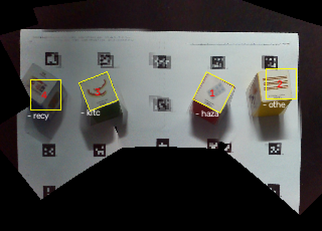

*图：所有视角融合后的顶面正射图（`docs/images/02`）。黄框为解出的顶面、编号与类别。*

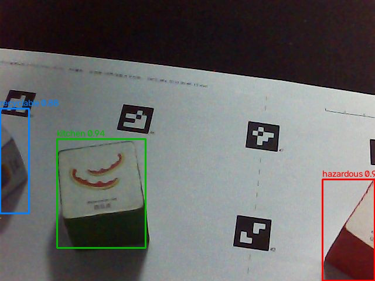

*图：单个腕部视角的检测（`docs/images/01`）。右侧物块被画面边缘裁切，这类框需要走 `approx` 路径。*

离线评分（15 轮 60 块，Mac 与板上结果相同）见上一节第 5 小节：中心误差中位 0.0 cm、p90 1.04 cm、最大 1.55 cm；朝向误差最大 36°；50/60 可直接抓。超出容差的 11 块全部是地图边缘块（正射图上被斜视拉糊），所以对“覆盖不足、得分 < 0.4、或 `approx`”的块，实机上会先补拍一张近景再抓。

**为什么不用多帧三角化**：2026-09-20 做过一个纯合成几何实验（**【仿真】**，`records/experiments/多视角方块定位离线实验.md`，角点噪声 1.5 px，1000 次）：

| 条件 | 位置误差中位 | p95 |
|---|---|---|
| 1 帧，已知顶面高度，平面求交 | 1.87 mm | 3.82 mm |
| 3 帧三角化，未知高度 | 4.34 mm | 12.45 mm |
| 2 帧三角化，未知高度 | 8.78 mm | 25.03 mm |

**已知高度（3 cm）时，单帧平面求交比少量宽基线视角三角化更准**。这是“射线 ∩ 已知高度平面”方案的依据。注意这个实验是合成几何，不是硬件精度。

### 3. ROI 棱边解算：从一个检测框解出中心与朝向　【离线；已接入板载定位，实机精度未统计】

**动机**：

- 旋转框（OBB）在图像里给的角度有透视偏差。本机计算（f = 977.383，640×480，距离 30 cm）的最大偏差：俯角 30° 时 3.1°，45° 时 8.3°，60° 时 19.8°。
- 项目扫描俯角正好在 30–60°，而抓取容差只有 12°，所以角度必须在**桌面平面**上求。
- 另外，颜色 blob 方法对贴纸朝上的物块给不出 yaw。

**方法**（`app/src/vision/roi_pose.py`，`solve_top_face(image, bbox, pose, k, dist)`）：立方体立在桌面上，相机位姿已知，它在图像里的**轮廓**就是 (x, y, yaw) 的已知函数。

1. **初值**：把检测框中心的像素射线与 Z = 15 mm 平面求交（等价于与 Z = 0、Z = 30 mm 两平面交点的中点），误差只有几毫米。
2. **轮廓模型**：按 (x, y, yaw) 生成 3 cm 立方体的 8 个角，投影到去畸变图像上，取凸包。
3. **目标函数**：`score = 轮廓边上的 |梯度 · 边法向| 加权均值 + 0.20 × IoU(轮廓外接框, 检测框)`。
   - 法向梯度项把 yaw 定到零点几度，并排除贴纸图案自身的边缘，因为那些边缘与轮廓方向对不上。
   - IoU 项只作粗先验。
4. **搜索**：
   - yaw 在 0–90° 内每 5° 粗扫。
   - 在 ±5 mm、±4° 内网格搜索。
   - 再做 3 轮步长减半的 pattern search。
   - 搜索半径受限，不允许跳到相邻物块上。
5. **结果**：顶面中心就在立方体中心正上方，解出 (x, y, yaw) 就是顶面中心与夹取角；yaw 折到 [−45°, 45°)。
6. **显式质量门**（任一不满足即 `ok=False` 并给出原因，不静默给错值）：
   - 框贴画面边缘；
   - 边缘得分 < 0.055；
   - 轮廓支持率 < 0.35；
   - 框 IoU < 0.55；
   - 解出的中心偏离初值 > 2 cm。
7. **接入**（`app/src/teleop/localization.py` 的 `locate_board`）：只有同时满足“拟合 ok、与颜色 blob 中心相差 ≤ 0.8 cm、落在地图内”才替换旧结果，否则保留旧结果，并在 `roi` 字段记录失败原因。
   - 0.8 cm 门限的由来：实测出现过一次拟合跳到相邻块、偏 1.2 cm 的错锁，被这个门限拒绝。

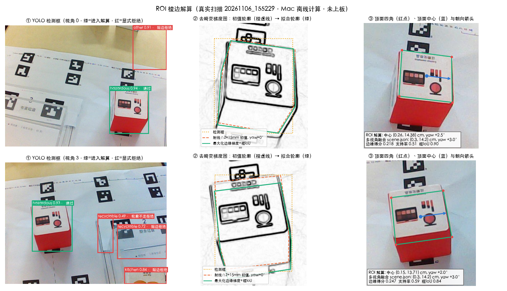

*图：本次用 `roi_pose.solve_top_face` 在真实扫描 `data/runs/pipeline/20261106_155229` 的视角 0 和视角 3 上重跑（Mac 离线，v3 检测器走 ONNX）。①检测框：绿色进入解算，红色被显式拒绝（贴边或轮廓支持不足）。②去畸变梯度图上，从射线初值（橙虚线）收敛到贴合棱边的轮廓（绿）。③顶面四角、中心与朝向。同一块有害物块，视角 0 解得 (0.26, 14.38) cm、+2.5°，视角 3 解得 (0.15, 13.71) cm、+2.0°；多视角融合的 `scene.json` 为 (0.3, 14.2) cm、+3.0°。中心相差 0.2–0.5 cm，yaw 相差 0.5–1°。*

**结果**（docs/current/28，2026-11-11）：

| 数据 | 条件 | 中心误差 | yaw 误差 |
|---|---|---|---|
| 合成渲染 **【仿真】** | 真实相机模型下渲染单块，随机 30 例，20 例过质量门 | 中位 0.03 cm、p90 0.39 cm、最大 0.44 cm | 中位 0.40°、p90 3.23°、最大 6.64° |
| 真实帧 **【离线】** | `20261106_155229` 的 8 个视角，4 个完整可见物块通过 | 与 `scene.json` 相差 0.1–0.6 cm | 与 `scene.json`（3° 量化）相差 0–2.5° |

- 合成集中未通过的 10 例全部是框贴画面边缘或遮挡导致支持率不足，被明确拒绝。
- 单块解算 **40 ms**（Mac＋uv，不含模型推理）。**板上耗时未测**。
- 合成集有 1 例 6.6° 的离群值（白贴纸/弱对比面），仍在 12° 容差内。

### 4. 朝向如何变成夹爪角度（与本节相关的已知偏差）

- 现用公式 `J5 = 92 + (block_yaw − (J1 − 90))` 只在末节竖直（pitch = 180）时严格成立。
- 本机计算的误差：pitch 150 时最多差约 **4°**，pitch 135 时最多差约 **10°**，占掉 12° 容差的一大半。
- 新解算器 `dev/tasks/grip_solver.py` 已离线可用。对 2026-09-26 的实测案例，它给出 J5 100.5°、残角 0.2°，与实测的 J5 100° 一致。
- 新解算器**未接入实机抓取**，需要先做 3 姿态 J5 标定（docs/28 §3–§5）。

### 5. 一条重要的实测教训：高度不能信相机 z　【实机，2026-09-27】

- 现象：触碰探测发现夹取一直偏高 **0.8 cm**。
- 原因：`use_registration` 把桌面高度设成了相机 PnP 的 z（−0.62 cm），覆盖了触碰标定值（−1.42 cm）。
- 后果：每次下探都高 0.8 cm，夹爪闭合在 3 cm 方块的上部三分之一，这里撬翻方块的力臂最大。
- 修复：只取 xy，z 用标定值。
  - 方块顶面探测从 1/4 碰到变为 **4/4**，中位误差 −0.15 cm；
  - 随后实机 **4/4 一次夹住、0 夹空，整轮 99 s**（docs/archive/stage1-research/11 §七）。

---

## 手势识别模型

### 1. 选型：先用课程 HRNet 四分类器　【文件 → 实机】

候选与结论（docs/archive/stage2-midterm/19、20）：

| 候选 | 芯片 | 结论 |
|---|---|---|
| **课程手势包 `hrnet.om`**（fist / like / ok / palm） | OM 内只有 `Ascend310B1`，与本板一致 | **采用**：零训练成本，免重转 |
| HaGRID + YOLOv10n 手势检测 / YOLOv8n-pose 手部关键点 | 社区在 `Ascend310B4` 上跑通 | 备选。可复用本项目 YOLOv8n→OM 链路，**本机未做** |
| 官方 `gesture_recognition_picture`（Caffe ResNet18，20 类） | `Ascend310` | 需重转，未采用 |
| `hand_detection_Gitee`（人手检测，Apache-2.0） | — | 计划用作手部 ROI，**未接入** |

模型事实（docs/21 §1.2）：

- **它不是关键点模型**，而是 HRNet-W18 骨干的 224×224 **整图四分类器**。输入 `input [1,3,224,224]` float32，RGB/255，无 mean/std；输出 `output [1,4]`。
- 4 类有三条独立证据：ONNX initializer `classifier.weight [4,2048]`、`.pth` 同名张量、OM 实际输出 `[1,4]`。早先有一版调研误判为 64 类，已更正。
- OM 内嵌的转换命令（`strings` 读出）：

```sh
atc --framework=5 --model=./model_2.onnx --input_format=NCHW \
    --input_shape=input:1,3,224,224 --output_type=FP32 --soc_version=Ascend310B1
```

- 文件信息：46,803,711 B，SHA-256 `4ce486cd…3d43c`，挂在 Release `assets-v4`。
- 来源：**原始出处未找到**，按“课程私有训练产物”对待，不对外声称是开源或官方模型。

### 2. 上板推理速度　【实机，2026-10-16】

证据：`2026-10-16-model-smoke.json`、`2026-10-16-npu-concurrency.json`。

- 单帧推理中位 **9.07 ms**（真实图像，9.03–9.75 ms，20 轮）；合成输入 9.10 ms。
- 与板上 onnxruntime 1.14 对照：logits 最大差 **0.00094–0.00139**，argmax 一致。
- 三模型共驻（语音 WeNet＋手势＋v3 检测器）：
  - 显存 +482 MB（1515 → 1997 / 3513 MB）。
  - 并发时手势 **21.8 ms**（约 46 fps 能力，相机只有约 7.6 fps）。
  - **session 不能跨线程共享**，否则 `ACL: general failure` 必崩。必须每个线程自建 session，或一模型一进程。

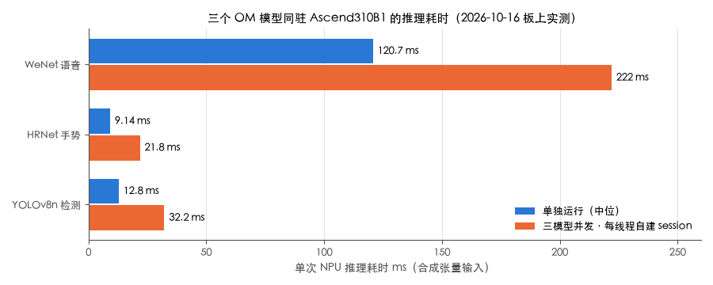

### 3. 识别率与域差异　【实机，2026-10-16；不是验收口径】

证据：`records/hardware-tests/2026-10-16-gesture-accuracy.json`。

- **训练域**：课程 `Gesture/val` 每类等距抽 60 张，板上跑。
  - 总体 **97.9%**：fist 96.7%、like 96.7%、ok 98.3%、palm 100%。
  - 这也确认了标签顺序 `0=fist 1=like 2=ok 3=palm` 与课程 Notebook 一致。
- **现场域**：操作员在腕部相机前真实比手势，每类一个会话、约 100 帧，合计 **71.2%**。
  - like 93.1%、ok 85.3%、palm 100%。
  - **fist 只有 5.9%**：101 帧里 95 帧被判成 palm，平均置信度 0.708；真 palm 是 0.997。
- 原因定位：训练集的 fist 是竖握、掌侧朝镜头、纯色墙背景；现场是手背朝镜头、逆光窗户、有人走动。
  - 用固定中心裁剪验证：**80% 裁剪时合计 92.1%**，fist 升到 77.2%。
  - 但没有一个比例对所有手势都好：like 在 ≤ 70% 时崩（拇指被裁掉），ok 在 ≤ 50% 时崩。
  - 结论：要做的是**手部 ROI 检测**，而不是写死裁剪比例。
- 2026-11-19 复测（`2026-11-19-asr-gesture.json`，单帧、自采样本）：**3/4**，like 0.99、ok 0.71、palm 0.999 判对，fist 仍被判成 palm（0.742）。

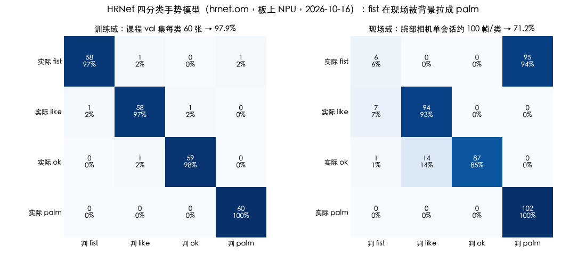

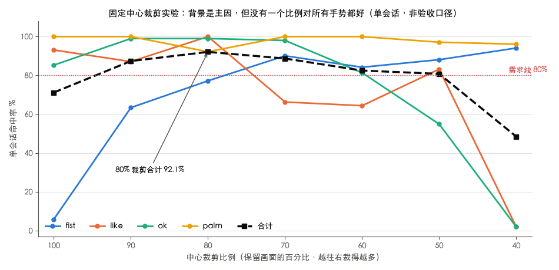

*注意：现场数字每类只有一个会话，相邻帧高度相关，真值是“操作员当时比的是哪个”，**不能当准确率**。需求 E1 要求 ≥ 3 类、≥ 80%、≤ 1.2 s，目前**没有验收数字**。*

### 4. 识别桥与指令规则　【规则：仿真＋单元测试；手势门：实机】

链路（`app/src/interact/bridge.py`，docs/current/25，2026-11-20 更新）：

```text
腕部相机快照(:8080) ─▶ src/vision/gesture.py (hrnet.om, ~6 帧/秒送判定)
        ─▶ POST <网关>/api/interact/gesture {label, confidence}
        ─▶ 网关 src/web/serve.py 持有 src/interact/intents.py：阈值/连续帧/冷却/武装
        ─▶ 受理：执行 start / stop / gripper，写日志 interaction 事件；流程脚本 wait_gesture 读同一份识别记录
```

规则（`app/config/interaction.json`，改规则不用改代码）：

| 参数 | 值 |
|---|---|
| 置信度阈值 | 0.6（沿用课程 Notebook） |
| 连续帧 | **连续 3 帧**同一手势才触发；一次保持只触发一次 |
| 冷却 | 2 s |
| 武装 | 识别端启动后**默认未武装**，只有 `stop` 永远放行（`always_allowed`） |
| 映射（2026-11-18 起） | `ok → start`、`palm → stop`、`fist → gripper:grip`、`like → gripper:open` |

- 安全约束：手势和语音**只能映射到固定指令**，不能带关节或坐标参数，免得一次误识别产生不可预期的运动。
- 任务运行中只允许 `stop`。实机使能需要页面上的现场确认，识别端不能自己产生这个确认。
- `stop` 的语义是“停止后续指令”，不是急停。
- 课程 Notebook 原本**每 60 帧推理一次**，按 7.6 fps 约 8 s 才判定一次。本项目改为逐帧送判定加连续 3 帧确认，以对齐 ≤ 1.2 s 的需求，但端到端时延未正式测量。

**实机手势门**（2026-11-19，**【实机】**，`2026-11-19-demo-and-tuning.json`）：

- 动机：俯视观察位看不到手。
- 流程：扫描后把相机抬到平视位姿 `[90, 60, 80, 40]`（指尖离桌 24.3 cm），蓝灯 200 ms 并短鸣，然后等**连续 3 帧 ok（置信 ≥ 0.6）**，最多 180 s；超时记录后继续，不卡整轮。
- 验证轮 `20261119_181226`：
  - 从抬起到受理 **7.4 s**，这包含操作员的反应时间，不是模型延迟；
  - 随后抓取，整轮 sorted 2 / skipped 7 / missed 0，用时 213 s。
- 现状：手势门已从 `run.py` 拆成流程步骤 `wait_gesture`（`config/flows/gesture_sort.yaml`）。“bridge → 网关 → `wait_gesture`”这条新链路**只在仿真里走通**，未接真识别进程做实机验证（docs/35 §9）。

### 5. 尚缺的

1. 手部 ROI 检测（`hand_detection_Gitee` 或自训 YOLO 手部检测）。
2. 多会话、逐帧标注的识别率验收。
3. 端到端指令时延（相机 → 识别 → 网关 → 执行）的正式测量。
4. 识别率验收之前，手势**只做指令旁路**，不参与类别判定、投放决策或安全联锁。

## 仿真模型

状态口径（全节通用）：**【实机】** 有实机日志或实测；**【回放】** 用实机录下的数据在 Mac 上离线复算；**【仿真】** 在 `dev/sim` 或纯离线几何中算出，没上过实机；**【文件】** 代码或配置已入库，没有运行结论。

### 1. 为什么要单独做一个仿真后端

`dev/sim/` 是独立的仿真后端，不导入 `Arm_Lib`，不接板卡。它对外提供与板上控制台同样的 `/api/*` 接口（token、owner、revision、心跳租约语义都相同），另加 `/api/sim/*`（场景真值、放块、立桶、注入故障、检测对照、三维网格）。用途有三个：

1. 前端（网页、手机 App）不接实机也能联调，事件流与实机同形；
2. 真实分拣流水线 `app/src/pipeline/run.py` 和新分步流程 `app/src/flow` 可以原样指向仿真地址跑整轮；
3. 用合成的腕部相机画面检查四类检测模型的前后处理和相机几何是否自洽。

启动：`uv run --with 'opencv-python<5' --with numpy --with onnxruntime dev/sim/sim_server.py [--map map_a4_v4 --bins bins_acrylic_v2_pair --blocks 4 --seed 0 --speed 4]`，页面在 `http://127.0.0.1:8770/sim/`（16 号文档 §1）。

**仿真本身不带几何**，全部读仓库里的模型与标定：

| 内容 | 来源 | 依据与状态 |
|---|---|---|
| 连杆与正逆解 | `app/src/spatial/dofbot_kinematics.py`（上游 URDF 尺寸，FK 夹爪长 12 cm） | 触点标定水平残差 2.8 mm【实机 2026-09-25】 |
| 相机位姿 | `app/config/calibration/hand_eye.json`，相机固定在腕部、不随 J5 转 | 独立姿态验证平均 1.4 mm【实机】 |
| 内参与畸变 | `camera_intrinsics.json`，f = 977 px，k1 = −0.48 | 棋盘格 RMS 0.35 px【实机】 |
| 限位、禁入区、心跳、状态对象 | 直接复用 `app/src/teleop/core.py` 的 `Controller` | 与板上控制台同一段代码 |
| 整臂碰撞 | `planning.body`：link1–4 课程网格体素点云（`arm_links_geometry.json`） | 与规划器同一套【文件】 |
| 夹爪 | `planning.gripper`：四连杆（`gripper_geometry.json`） | 见下文 §3 |
| 底座平台 | `platform_model.json` 圆角方台 | 见下文 §4 |
| 物块贴面 | `data/reference/block_faces/` 20 张实拍面 | 实拍照片 |
| 垃圾桶 | `bins_acrylic_v2_pair.json` 等设计文件 | **设计值，未实测** |

2026-11-19 起，仿真的抓取判定、碰撞记录和三维视图全部换成规划器的同一套模型（34 号文档 §3），这是“新的仿真模型”的核心：**仿真判据和规划器判据不再是两套几何**。

### 2. 整臂：课程 STL + 上游 URDF

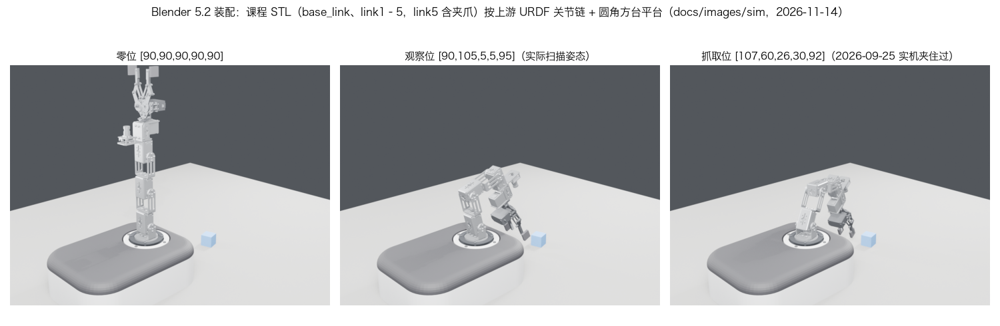

- **来源**：课程包 `资料/展开资源/三维结构文件/` 的 `base_link`、`link1…link5.STL`，按上游 URDF（提交 `9d10827`）关节链装配；装配后的 FK 与 `dofbot_kinematics.py` 逐点一致，差 < 0.1 mm【仿真，28a §1】。`link5.STL` 自带夹爪（两指、四连杆、夹爪舵机）。
- **官方模型之间的差异**：URDF 与 NVIDIA Isaac 的 Dofbot USD 在 J4→J5 段差 **8.35 mm**（73.85 vs 65.50 mm），FK 夹爪 120 mm vs USD 指尖 116.99 mm，base→指尖合计差 11.35 mm（27 §3）。现有标定都按 URDF + 120 mm 拟合，所以仿真也沿用这套，没有半改。
- **网格级碰撞的可信度**：把 link3–link5 网格（3 mm 体素）放到全部实机读回姿态上——1080 个落到面板顶面 +3 cm 以下的安全姿态和 5 次记录过的平台接触——不用任何拟合参数就把两类分开，平台附近误差约 3 mm【回放，28a §6，2026-11-14】。这是后来把“网格判据”接进规划器和仿真的依据。
- **网页三维**：`dev/sim/web_meshes.py` 把课程网格按 4 mm 抽稀（夹爪 2 mm），约 1.9 万个三角形、300 KB；2026-11-20 起入库为 `dev/sim/assets/web_meshes.json`（提交 b8d192e），克隆即可画出机械臂。

### 3. 夹爪：从 STL 拆出的平行四连杆

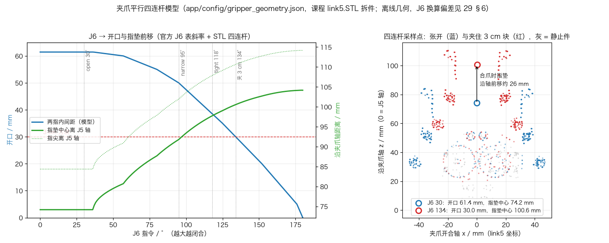

`dev/scripts/blender_extract_gripper.py` 把 `link5.STL` 的 62 个壳体分成两根手指、上惰轮连杆、下齿轮连杆和静止件，写入 `app/config/gripper_geometry.json`，计算在 `app/src/spatial/gripper_geometry.py`（纯 Python，板上可跑）。

- 每侧上下两根连杆都是 **30.0 mm 且平行**（右 30.001/30.001，左 29.999/29.999 mm），所以手指**不转动，只沿 30 mm 半径圆弧平移**（29 §1）。
- 本次用仓库代码离线复算（2026-11-20，Mac）【仿真】：

  | J6 指令 | 开口 | 指垫中心离 J5 轴 | 指尖离 J5 轴 |
  |---|---|---|---|
  | 30（控制台 open） | 61.4 mm（网格上限） | 74.2 mm | 84.4 mm |
  | 95（narrow） | 50.0 mm | 91.8 mm | 101.9 mm |
  | 118（tight） | 38.5 mm | 97.8 mm | 107.9 mm |
  | 134 / 夹住 3 cm 块 | 30.0 mm | **100.6 mm** | 110.6 mm |
  | 168（触地用） | 10.0 mm | 103.9 mm | 113.9 mm |
  | 180（全闭） | 0 | 104.2 mm | 114.1 mm |

- **关键结论：从张开到夹住，指垫沿夹爪轴前移约 26 mm**。俯仰 150° 时相当于水平外移 1.3 cm、下沉 2.3 cm。它解释了旧经验值“张开时目标外移 1 cm”：按模型其中 9.7 mm 来自指垫后缩，残差 2.6 mm（`test_motion_planning.py`）。
- 规划和仿真都以**闭合指垫中心**为 TCP，不再用 FK 的 12 cm 虚拟指尖。
- 与实机的对照：实测全开内间距 **64 mm**【实机 2026-11-13】，网格上限 61.4 mm；3 cm 块本机命令 133° 夹住，官方表写 134°【实机】。但 14 次夹 3 cm 块回读 127–129°、手持慢合约 124° 开始落后，说明本机接触比官方表早 5–10°（29 §6，离线分析，待 `gripper_probe.py` 实机确认）。夹住时的指垫位置按块宽从几何直接算，不经过这张表，不受影响。
- 旧的参数化模型图 `docs/images/gripper_model.png`（2026-11-06，Isaac USD 变体，最大 44.7 mm）已被四连杆模型取代，本节没有沿用。

### 4. 底座：圆角方台

- **形状**：用户 2026-11-14 照片——方形黑色面板 + 白色机箱，大圆角，上沿往下卷。
- **参数**（`app/config/platform_model.json`）：顶面 z = +7.6 cm，前沿 y = +8 cm，半宽 11 cm，后沿 −22 cm，竖直圆角 6 cm，卷边半径 2 cm，面板厚 2.2 cm。
- **来源分级**：顶面与前沿来自 2026-09-25 拟合的禁入区【实机】；圆角与卷边由 1080 个实机姿态 + 5 次接触拟合【回放】——数据要求前沿 8 cm、半宽 11 cm 时圆角 ≥ 5.5 cm、卷边 1.5–2 cm；**半宽、后沿、法兰孔径是照片估计，未实测**。
- **核验结果**【回放，28a §6】：

  | 平台形状 | 最深的无碰撞姿态 | 最浅的接触 | 结论 |
  |---|---|---|---|
  | 圆柱 r 8 cm（旧禁入区） | +0.01 cm | +0.22 cm | 一致 |
  | 圆角方台（现行） | +0.13 cm | +0.14 cm | 一致 |
  | 同尺寸直角方台 | +0.82 cm | +0.42 cm | 被否定 |

- 方台在 J1 偏离 90° 时比 8 cm 圆柱多出 0.2–3.4 cm（J1 = 20/160 时 +3.4 cm），所以近端边界随 J1 外移。仿真里两次有记录的实机平台接触 `[103,72,19,3]`（压入 0.8 mm）、`[90,102,−5,−1]`（压入 4.9 mm）都判为接触，三个跑过无接触的近处观察位判为不碰（`dev/tests/test_sim.py`）。

### 5. 合成相机与深度缓冲三维

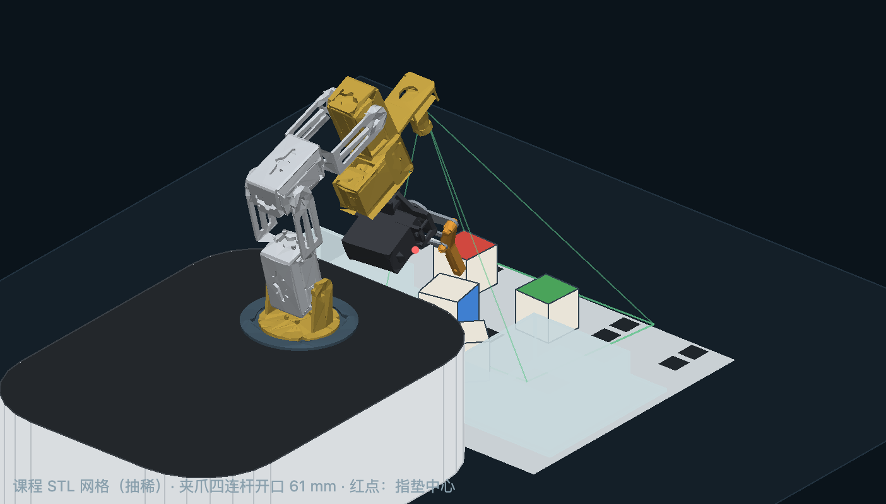

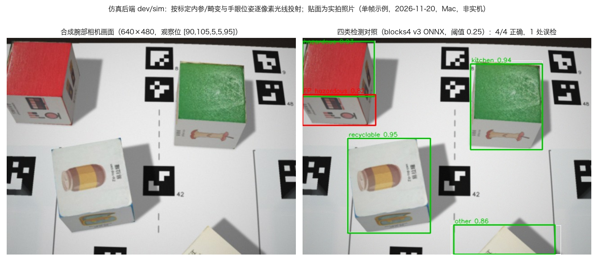

- **合成相机**（`dev/sim/render.py`）：640×480，按标定内参/畸变逐像素光线投射；画地图 ArUco 码（从地图 JSON 重绘）、桌面、贴实拍面的 3 cm 块、桶（透明亚克力 + 贴纸）、Lambert 光照、软阴影、暗角、模糊和传感器噪声。**不画机械臂自身、不画平台**，没有曝光变化。
- **三维视图**（`dev/sim/web/app.js`）：整臂 STL、四连杆夹爪（手指按四连杆平移、连杆绕销轴转，位姿来自 `/api/sim/body`，与 `planning.gripper` 逐点一致，测试误差 < 1e-9 m）、圆角方台、物块、桶、相机视锥，红点为指垫中心。2026-11-20 起由画家算法改为**软件深度缓冲**：每个图元光栅化写深度，修正了方块透过平台和机械臂显示的遮挡错误（提交 1b8d83b）。投影为正交，深度在屏幕空间线性插值。
- 上面两张图是本次在 Mac 上启动独立仿真实例（端口 8779，`map_a4_v4` + 双桶，4 块、种子 3）截取的单帧【仿真，2026-11-20】：观察位 `[90,105,5,5,95]` 下 4/4 块检测正确，另有 1 处误检（把红块侧面单独框成一个“有害垃圾”）。单帧不代表统计。
- **批量一致性检查**【仿真，2026-10-11，16 §4】：50 场景 × 6 视角、每场景 4 块，`blocks4/v3` ONNX，阈值 0.25：应检出 518，正确 499，类别错 9，漏检 10，误检 20；召回 96.3%，精确率 94.5%。**这不是实机精度**：贴面就是生成合成训练帧的那 20 张照片，没有真实光照、背景和机械臂遮挡。

### 6. 仿真里的抓取判据与故障注入

接触物理没有建模，抓取用规则判定，阈值按实机记录回放确定（`dev/tools/grasp_replay.py`，`data/runs/console_grasp/log.jsonl` 里 2026-09-25 至 11-06 共 43 次合爪，其中 16 次能还原方块位置且夹爪真的合上：实机夹住 13、空夹 3）：

| 判据 | 与实机一致 | 实机夹住→判夹住 | 实机空夹→判空夹 |
|---|---|---|---|
| 初估（重叠 ≥ 5 mm、对正 ≤ 30°） | 8/16 | 8/13 | 0/3 |
| 旧判据（FK 指尖在块中心 2 cm 内） | 13/16 | 13/13 | 0/3 |
| 11-19（重叠 > 0、横向 ≤ 10 mm、对正不限） | 13/16 | 13/13 | 0/3 |
| **11-20 现行**（再加目标“芯”内缩 5 mm、对正 ≤ 40°） | **14/16** | 13/13 | 1/3 |

- 推翻初估的证据：3 次偏 36–39° 仍夹住（回读 128），3 次重叠只有 0.9 / 1.9 / 4.5 mm 仍夹住；横向偏差最大 8.8 mm 仍夹住【回放】。
- 回放用的是指令姿态和当时估计的方块位置，不是真值（地图配准约 1 cm，J2 实际比指令少约 2°），只能核对阈值，测不出精确边界；空夹一侧判别力弱。
- 夹住后回读：夹住 129°、空合 132°（实测口径，常数）。可注入故障：`grip_miss`（合爪夹空比例）、`servo_bias_deg`（J1–J5 隐藏偏差，模拟回读正确但实际偏）。

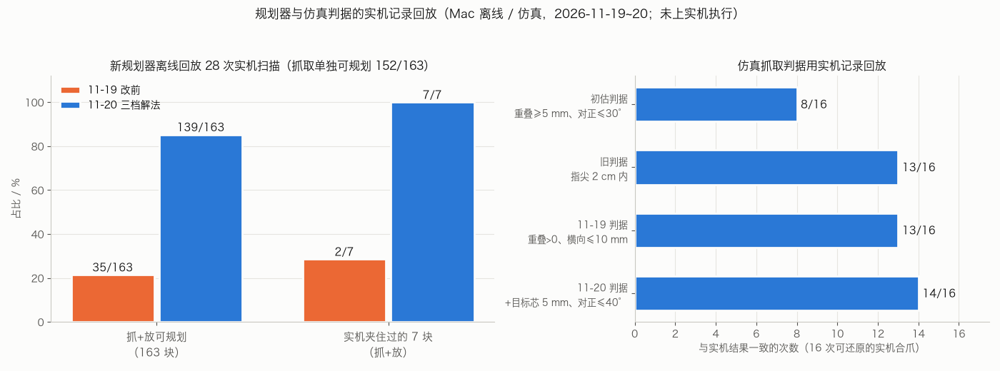

### 7. 仿真能验证什么、不能验证什么

| 能说明 | 不能说明 |
|---|---|
| 几何、接口调用、日志事件在整条流程里自洽（流程整轮跑通，事件符合日志契约） | 实机成功率：仿真没有舵机死区/下垂/延迟、夹爪不响应、块被碰动这些实机主要失败来源 |
| 规划给出的姿态不压平台网格、不碰桶壁、不碰邻块（与规划器同一套模型自查） | 物块被推挤、翻倒、互相碰撞（只记录 `block_contacts`，不改变结果） |
| 定位链路与检测前后处理一致：8 视角扫描后地图注册 (0.07, 6.76, −1.43) cm，标定值 (0.07, 6.75, −1.42)【仿真 10-11】 | 定位精度：仿真无伺服位姿噪声，定位 ≤ 0.15 cm；实测 p90 是 0.6 cm |
| 前端可对着与实机同形的事件流开发 | 桶位、槽位、投放高度（都是设计值） |

端到端结果【仿真，2026-11-19，`dev/sim/flow_check.py`】：`reachable` seed 7、`edge`（近边带）seed 7、`random` seed 11 三轮均执行成功、核对通过，放置偏差 0.22 / 0.19 / 0.16 cm，碰桶/平台/块均为 0。旧流水线在仿真里 seed 3、5 均 4/4 分拣，但记录到 1 次和 5 次手指擦到相邻方块（旧模型根本不记录这类接触）。带桶分拣（`map_a4_v4` + 双桶，seed 41–50，每轮 4 块其中 2 块有对应桶，`dev/sim/compare_sort.py`）：新分步流程投对 8/20、碰桶 5、碰块 0；旧流水线投对 9/20、碰桶 3、碰块 2【仿真，2026-11-20】。两者都低，主因是随机布局常把块放在离桶壁 2–3 cm 内。

---

## 路径解算到回传

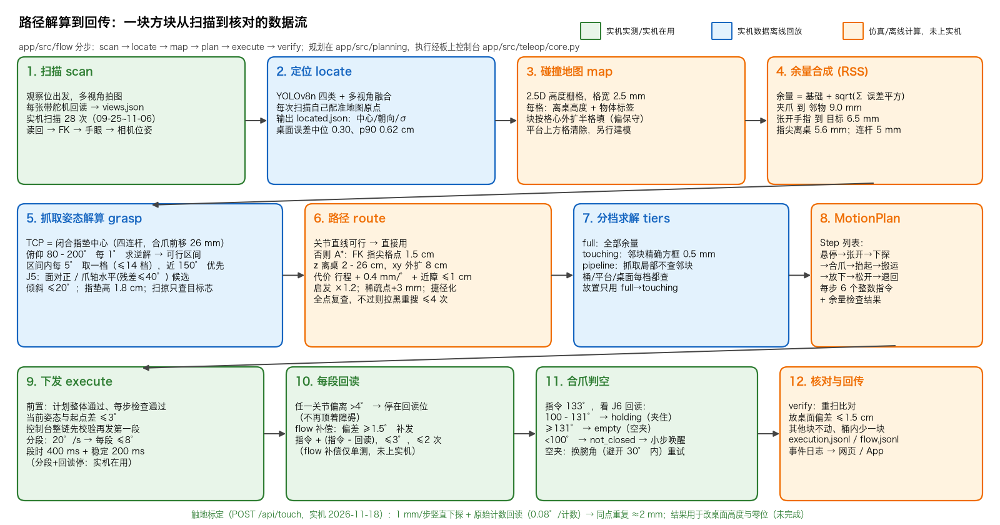

分步流程 `app/src/flow`（`scan → locate → map → plan → execute → verify`）每一步都是一个函数、一个 CLI 子命令，步骤之间靠会话目录 `data/flow/<时间戳>/` 里的文件交接，也可以单独指定输入。规划代码在 `app/src/planning`，执行经板上控制台 `app/src/teleop/core.py`。

**当前默认**：用户 2026-11-19 决定，网页/语音/手势/App 的「开始」仍走已在实机验证的旧流水线（`run.py` → `console_grasp`）；新规划器保留为试验（S1–S7 单步），等离线复查不比旧流水线差再切回（34 §6）。下文第 1–7 步的新规划器**全部未上实机执行**；第 8–11 步的控制台分段、回读停、合爪判空、触地是实机在用的部分。

### 1. 扫描与定位 → 场景

- **扫描**【实机】：从观察位出发多视角拍图，每张图带舵机回读写进 `views.json`；回读经 FK → 手眼 → 相机位姿。`data/runs/pipeline/` 里有 28 次带 `views.json` 的实机扫描（2026-09-25 至 11-06）。
- **定位**【回放】：YOLOv8n 四类 + 多视角融合；每次扫描用自己的配准原点把块放进底座系（地图在会话之间被挪动过：9 月 25–27 日偏约 1 cm）。输出 `located.json`：中心、朝向、sigma（误差配置与配准离散度的平方和根）。
- **相机模型检验**【回放，2026-11-15】：416 张带回读的实机视图、345 张能看到标记；按每次扫描自己配准，标记投到桌面的误差中位 0.30 cm、p90 0.62 cm；角点像素误差中位 11.1 px。内参无问题，误差来自伺服位姿（每张图约 ±1.5° 滚转）。规划里目标 xy 误差取 5 mm 就依据这里的 p90。
- 识别与定位回归：15 轮手摆 60 块，找到 60、类别全对，中心误差中位 0.0 / p90 1.04 / 最大 1.55 cm，与 09-26 记录逐项相同【回放，11-19】。

### 2. 碰撞地图（2.5D 高度栅格）

`app/src/planning/collision_map.py`，格式 `dofbot-collision-map/1`（JSON 或 npz），底座坐标系，单位米。

- **格宽 2.5 mm**（`planning_tuning.json` `map.cell_m = 0.0025`）；每格记录顶面离桌高度（0 空，null 未观测，默认当空）和物体标签；物体清单带名称、类别、中心、尺寸、偏航、`sigma_xy_m`。
- 高度**相对桌面**记录，换桌面估计不用重建图；物块按“格心落在物块外扩半格内”填格，量化误差 ±半格、总体偏保守；桶是四壁 + 底板合成的一个物体，块可以从桶口放进去。
- 加载时清掉平台面板上方的格子（`clear_platform`），平台和机械臂自身单独建模。
- 查询：每个碰撞点与“按余量半径球膨胀后的地图”比较，得竖直余量；不同余量的膨胀结果缓存，查询向量化。被抓的块按标签排除出地图，再按精确盒子单独检查（合爪时允许贴到 0.5 mm）。
- 地图谁都能写：扫描定位（`flow.build_map`）、仿真、手写，或 `scene.Box` 列表光栅化。

### 3. 余量合成

误差与基础余量分开配置（`app/config/planning_tuning.json`，2026-11-15，**未在实机上调过**）：

- `errors`：目标 xy 5 mm、偏航 5°；障碍 xy 4 mm、高度 3 mm；桌面高 2 mm；手臂 xy、z 各 3 mm。
- `clearances`（基础余量）：邻物 4 mm、目标（张开）0.5 mm、手臂连杆 5 mm、途中离桌 1 cm、指尖离桌 2 mm（夹住）/ 1 mm（空夹全闭）、平台网格 1 mm、目标芯内缩 5 mm。
- 合成方式 `combine = rss`：余量 = 基础 + sqrt(各相关误差平方和)；可改 `sum`（最坏情况相加）。

| 余量 | 组成 | 默认值 |
|---|---|---|
| 夹爪到邻物 | 邻物 ⊕ 障碍 xy ⊕ 手臂 xy | 9.0 mm |
| 张开的手指到目标 | 目标 ⊕ 目标 xy ⊕ 手臂 xy ⊕ 偏航误差的角点外扩 | 6.5 mm |
| 指尖离桌 | 指尖 ⊕ 桌面 ⊕ 手臂 z | 5.6 mm |

`trims`（实机微调：桌面修正、指垫高度 1.8 cm、抓取/放置偏移、J5 修正、合爪指令 133°、首选俯仰 150°）**只改下发指令，不改检查**：`Step.command` = 模型关节角 + 修正量，检查始终按模型关节角做。

### 4. 抓取姿态解算（`solver.py`、`grasp.py`）

输入：`Target`（块中心、偏航、尺寸、sigma）+ 起始姿态；输出：`Grasp` 候选（俯仰、J5、开口档、指垫高度、悬停位、各项余量）。

1. **TCP 逆解** `solve_tcp`：目标点是闭合指垫中心（四连杆在“夹住 30 mm 块”时的位置），不是 FK 指尖。初值先把 FK 指尖沿工具轴推出指垫深度，再迭代 FK-tip 逆解修正残差（最多 12 次，收敛 < 0.1 mm），只对收敛解检查关节下限。2026-11-15 前下限查在离目标约 2 cm 的初值上，导致近处、陡俯仰被大量误拒（30 §10.2）。
2. **俯仰逐度解算** `pitch_range`：在 80–200° 间每 1° 求一次指垫逆解，留下关节限位内的，形成可行区间；`spread` 在区间内每 5° 取一档、两端必取、最多 14 档，按离首选俯仰 150° 的远近排序（`motion_planning.json` `grasp.pitch_scan`）。旧版固定 130–185° 档并写死 28 cm 上限，已删。按模型（J1 = 90、指垫高 1.8 cm）：12 cm 处 171–181°，20 cm 处 148–163°，27 cm 处 99–141°，31 cm 处 107–124°，32 cm 无解【仿真】。
3. **J5 对齐** `roll_candidates`：在 J5 90–270°（每 0.5°）里找夹爪开合轴相对块面残差的局部极小，半圈、四分之一圈都作为候选，并给出开合轴倾斜。排序：对正（≤ 12°）→ 倾斜 ≤ 15° → 残差 + 0.5×倾斜 → 离零位 92° 近。2026-11-20 增加“爪轴保持水平”的候选：残差 ≤ 40° 时可用，靠合爪的指垫把块扳正（依据：实机偏 36–39° 仍夹住；正对棱角 ≈45° 在 09-27 两次弹飞）。
4. **四连杆补偿**：指垫中心定在离桌 1.8 cm（块中部）；开合轴倾斜时指垫可抬高 0–8 mm（每 2 mm 一档），中心仍在块顶以下 6 mm；张开档从宽到窄试 open 30°（61 mm）→ narrow 95°（50 mm）→ tight 118°（38.5 mm）。
5. **候选的硬约束**：关节在限位内；夹住时指尖离桌、空夹全闭指尖离桌满足余量；不进平台网格（1 mm）；从悬停位下探和张开/合拢扫掠不碰邻物；**合拢扫掠只查目标块内缩 5 mm 的“芯”**（侧面接触放行）；开合轴倾斜 ≤ 20°（硬上限，依据：实机倾斜 17° 夹住、28.7° 空夹）。
6. 悬停高度依次试 4 / 3 / 2 / 1.5 cm。

放置（`release.py`）同理：块中心落在目标点，底面离桌 3 mm（投桶时离桶沿 1.5 cm）；上方位依次试抬高 3 / 2 / 1.5 / 1 cm；底面倾斜上限桌面 17°（11-20 由 8° 放宽，依据实机 29 次放下俯仰差最大 16° 全部放成）、投桶 25°。`plan_pick_and_place` 按放置结果反选抓取候选：抓取时块在指间的姿态决定了放下时能否保持水平。

已知的结构性限制（5 自由度）【仿真】：远处俯仰越平，转 J5 带来的爪轴倾斜越大，31 cm 处朝向只能偏离约 18° 以内；陡俯仰抓起的块只能平放在近处，平俯仰抓起的只能放远处。

### 5. 路径：直线优先，否则 A*（`route.py`）

1. 先试**关节空间直线**（按 120 点/米采样、至少 4 点），整条检查通过就直接用。
2. 不通时在 **FK 指尖格点**上跑 A*（`planning_tuning.json` `search`）：
   - 格点间距 **1.5 cm**，锚在起点指尖；z 取离桌 2–26 cm，xy 在起终点外扩 8 cm 的范围内；26 邻域；
   - 每个节点用 IK 求出让指尖落在该格点的位姿，俯仰和 J5 按“沿起终点直线走了多远”插值，够不到时退到 `pitches_deg`（150、140、160、130、170、120、180、110、185、100、90）里最近的几档；
   - 代价 = 指尖行程 + **0.4 mm/度**（最大关节变化）+ 近障惩罚（余量 2 cm 内线性增加，最多 1 cm）；启发项 = 到终点直线距离 × **1.2**；最多展开 6000 个节点；相邻节点关节跳变 > 25° 不连；
   - 节点用“隔 3 取 1”的稀疏碰撞点、余量额外加 3 mm；边在出队时才检查（lazy），不通就换次优父节点。
3. 找到后**捷径化**：从每个点直连最远的可直达点；每一段再用全部点重新检查，若稀疏查过、全量不过，就把这段拉黑重跑 A*，最多 4 次。返回的路径不依赖稀疏检查。
4. 起点或终点本身不净空，直接报“start/goal pose itself is not clear”。
5. 碰撞对象：link1–4（课程网格点云，余量 1.2 cm 含误差）、四连杆夹爪（当前开口）、被夹的块、地图、桌面、平台网格。

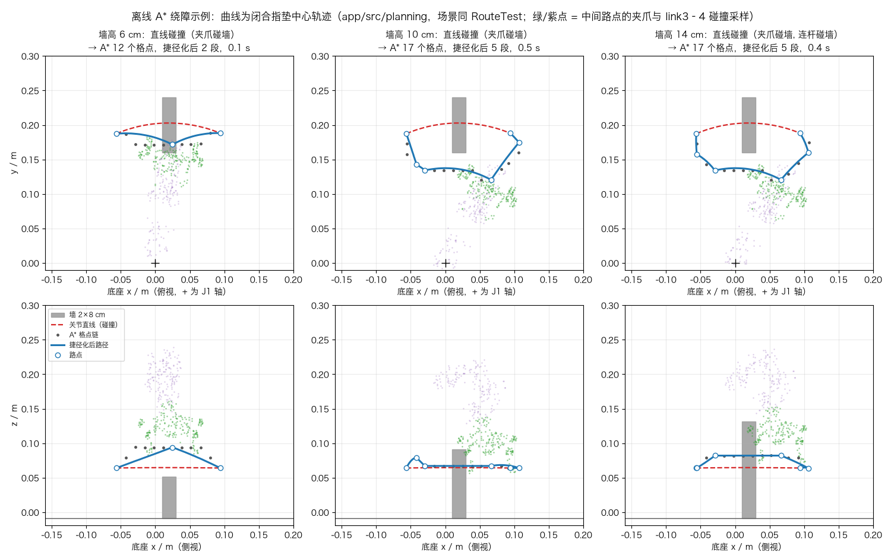

**离线示例**【仿真，本次复跑，2026-11-20，Mac，`app/src/planning` 原样代码，场景同 `app/tests/test_motion_planning.py` 的 `RouteTest`】：起点/终点为指垫中心在 (−6, 20) cm 与 (10, 20) cm、离桌 5 cm、俯仰 150°、J6 = 30 张开，解得 `[106.7, 63.5, 33.0, 23.5, 92]` → `[63.5, 49.4, 54.9, 15.6, 92]`；中间立一堵 2×8 cm 的墙。

| 墙高 | 关节直线 | A* 格点链 | 展开节点 | 捷径化后 | 用时 |
|---|---|---|---|---|---|
| 6 cm | 夹爪碰墙 | 12 | 74 | 2 段（从墙上方越过） | 0.1 s |
| 10 cm | 夹爪碰墙 | 17 | 466 | 5 段（绕到墙靠底座一端） | 0.5 s |
| 14 cm | 夹爪、连杆都碰墙 | 17 | 312 | 5 段（绕行） | 0.4 s |

（30 号文档 11-15 记录同一场景为 0.3 / 1.4 / 1.1 s、2–5 段；耗时差异来自代码版本与机器。另有记录：前臂扫过的位置立 14 cm 立柱，直线碰连杆、A* 约 2 s 绕开；立柱 18 cm 无解。）

### 6. 分档求解 full / touching / pipeline

2026-11-20 起抓取按三档依次试，前一档拿不出方案才降档（`planner.grasp_tiers`，结果带 `grasp_tier`）：

1. **full**：全部余量。
2. **touching**：邻块从地图里拿出，按精确方框处理，余量 0.5 mm；桶和其他物体只保留位置误差（约 5 mm），不再用地图里最大的 sigma 放大所有物体。
3. **pipeline**：抓取局部（下探、张爪、合爪、抬起）不查邻块，与旧流水线一致；桶、平台、桌面、目标块照查；去悬停位的路径仍按 touching 档避开邻块。

放置只用 full → touching（不把块放到别的块上），并从抓取所用的档开始。依据：11-06 那几次挤满方块的实机扫描里，实机夹住了 4 块，按模型它们离邻块 +7.8 到 −5.8 mm，而 full 档要求 10.5–14.2 mm【回放】。

**结果**【回放，28 次实机扫描、163 块，离线跑 定位→建图→规划，不动机械臂】：

| 版本 | 抓取可规划 | 抓 + 放 | 实机真正夹住过的 7 块 |
|---|---|---|---|
| 2026-11-19（改前） | — | 35/163（21%） | 2/7 |
| 2026-11-20（三档 + 改检查） | **152/163**（够得着的 152 块全部） | **139/163** | **7/7**（抓 + 放） |

够不着的 11 块（32 cm 以外、11.5 cm 以内）经 FK 暴力采样确认确实够不到。11-19 版的拒绝原因第一条：指尖离桌太近 79、够不到或无可用俯仰 21、碰邻块或目标块 19、放置处碰撞 9；主因是只考虑“爪面对正”导致爪轴倾斜、指尖压桌，以及邻块余量偏大（34 §4.2）。

退路：夹空重试时避开刚才腕角 30° 以内的抓法（偏差落到爪轴方向，余量从约 10 mm 变成约 16 mm），无别的腕角时退回原角；扫描可近看补拍（`refine: true / block`）。

规划输出 `MotionPlan`：一组 `Step`，每步是“移动 J1–J5（关节直线）”或“只动 J6”，带 6 个整数 `command`、是否夹着块、控制台动作名、本步余量检查；抓取为 悬停 → 张开 → 下探 → 合爪 → 抬起，放置为 搬运 → 下放 → 松开 → 退回（投桶时在投放高度直接松开）。摘要另给 `j5_verified`（J5 是否在实机验证过的 90–180°）、`pitch_verified`（135–155°）和 `console_hull_min_cm`（控制台二维包络余量，< 0 时控制台标准判据会拒绝）。单次抓取规划约 0.2–0.5 s【仿真】。

### 7. 下发执行：分段与速度

`flow.stages.execute` 发指令前查三件事：计划整体通过、每一步检查都通过、当前姿态与计划起点相差 ≤ 3°。默认空跑，`--really` 才发送。

控制台对每次移动（`Controller._move`）：

- **整链先校验**：把整段路径按 `max_step_deg` 线性插值成多段，每段都过限位与禁入区检查，全部通过才发第一段，避免中途卡住【实机在用】。
- **速度只有一个参数**（°/s，单关节最大角速度，`app/src/teleop/motion_policy.motion_for`，32 §1.3）：
  - 每段最大步长 = clamp(速度 × 0.4 s, 3°, 15°)
  - 段时 = max(250 ms, 1000 × 步长 / 速度)
  - 稳定等待 = clamp(300 − 5 × 速度, 120, 300) ms
  - **默认 20°/s → 每段 ≤ 8°、段时 400 ms + 稳定 200 ms**；范围 3–40°/s。6°/s 约等于旧标准档（5°/800+300 ms），37°/s 约等于旧 explore 档（15°/400+120 ms）。
- 状态：2026-09-25 起实机操作和自动任务都跑在 explore 档（15°/400+120 ms）下【实机】；速度滑块与 20°/s 默认值 11-18 已在代码中，32 号文档记“40°/s 上限与摇杆每段回读耗时未实测”，**没有找到按 20°/s 计时的实机记录**。
- 规划里的 narrow / tight 开口控制台没有对应动作，由 J6 点动 10/5/2/1° 逼近【文件，未实机】。

### 8. 舵机回读

- **每段回读**【实机在用】：每段发完等段时 + 稳定后读回；任一关节偏离指令 > **4°**（`readback_tolerance_deg`）就把指令改成回读位置（停在原地，不再顶着障碍），报“遇到阻力或偏差”，不自动退回。flow 执行另在偏差 > 4° 时停。
- **回读补偿**【单测，未实机】：flow 每步移动后某关节偏差 ≥ 1.5° 就补发“指令 + (指令 − 回读)”，多出部分 ≤ 3°，最多 2 次（`planning_tuning.json` `execute`）。依据：988 对实机指令/回读（2026-09-24/25），J2 抬起时短 1.3°（力臂 5–15 cm）/ 2.0°（> 15 cm），32% 的动作 J2 偏 ≥ 2°；J2 差 2° 在 20 cm 处约 0.7 cm【实机数据】。
- **精确回读**【实机 2026-11-18】：舵机位置寄存器 2200 计数 = 180°（J5 3320 计数 = 270°），约 0.08°/计数。`Arm_Lib` 先 `int()` 截断再对 J2–J4 做 `180 − pos` 镜像，所以整数回读在 J2–J4 上平均偏高 0.5°、J1/J5/J6 偏低 0.5°。观察位静止 5 次：整数 `[90,105,5,5,92,11]`，原始 `[90.16,104.65,4.58,4.66,92.22,11.05]`，重复读变化 ≤ 1 计数。接口 `GET /api/precise`（只读，动作中拒绝）。以前所有基于整数回读的标定都带这组偏差，**换坐标后要统一重标，不能混用**。

### 9. 合爪判空

控制台 `gripper('grip')` 发 J6 = 133°，按 J6 回读分类（`safe_arm.grip_state`，阈值 `arm_limits.json` `gripper`）【实机标定 2026-09-24/25】：

| J6 回读 | 判定 | 含义 |
|---|---|---|
| 100° ≤ 回读 < 131° | `holding` | 被块挡住（实机夹住读 128–129°） |
| ≥ 131° | `empty` | 合到指令位置，空夹（实机读 132°） |
| < 100° | `not_closed` | 舵机没响应（张开后读回停在 29°） |

- `not_closed` 的处理：`wake_and_grip` 先直接合爪，不响应再用 J6 小步 +2° 唤醒（回读上升 ≥ 3° 才算醒），最多 3 次。实机日志里有 23 次 `gripper_wake_refused`、6 次 `gripper_not_closed`、2 次 `gripper_still_asleep`（09-25/26），11-18 又出现一次；原因未查清，更像张开端有机械卡滞（29 §6）。
- `empty` 的处理：旧流水线退回重扫找回这块再抓（`pipeline_retry`）；新流程换腕角重试。

### 10. 触地标定与精确回读（`POST /api/touch`）

目的：用夹爪慢慢碰桌面，得到精确接触姿态，标定桌面高度和关节零位【实机 2026-11-18，板载控制台 `--hardware --execute`】。

- 指尖在当前 x、y、俯仰下竖直下降，每步 1 mm，小数角度指令；每步用原始回读算指尖高度，与指令高度之差为“差值”。段时 250 ms + 稳定 150 ms。
- 接触判据：刚性——差值比最近 6 步最低值高出 3 mm 连续两步，或一步高出 6 mm；软接触——最近 7 步斜率 ≥ 0.4 mm/步且比最近低点高 ≥ 1.5 mm，判出后再走 3 步留数据。判出后指令改为当前回读，不再下压；任一关节偏离 > 4° 也按接触停。接触高度离线用折线拟合找拐点。
- 实测舵机特性：J2 逆重力方向约 1.5–2° 死区；去趋势噪声 J2 0.12–0.28°、J3 0.21–0.29°、J4 0.06–0.12°，折到指尖约 0.7–0.8 mm；接触后舵机仍按约一半速度“下沉”（16–17 步共约 9 mm），推测是支架/塑料件/齿隙变形。
- 精度：同一点重复拐点差约 **2 mm**（19 cm 点 −0.99 / −0.76 cm；23 cm 点 −1.55 / −1.32 cm）；**23 cm 处比 19 cm 处低约 6 mm**，远大于重复误差——伸得越远 FK 指尖越偏低，这是待标定的信号（J2 零位或伸展下垂）。
- 可辨识性【仿真，`fit_touch.py` / `touch_bench.py`】：埋入已知误差跑 27 个触点，“桌面 + 零位”模型残差 0.30 mm，零位只能分辨到约 ±0.5°；**平桌面竖直触地主要定高度，水平偏差测不到**。
- 未完成：21:35 起 16 点竖直触地已在板上运行，跳板手机约 21:50 掉线，结果（`/root/arm-app/data/runs/touch/20261118_213504/`）尚未取回，**是否跑完未确认**。`motion_planning.json` `table_z_model_m`（−0.87 cm，整数回读坐标）和 `arm_limits.json` `table_surface_z_m`（−1.42 cm）在新坐标标定前不改。

（相关的“近处精度”背景：旧触点标定 5 个点按 12 cm FK 指尖得桌面 −1.42 cm、水平残差 2.8 mm；按四连杆网格最低点换算为 −0.87 ± 0.12 cm【回放】。）

### 11. 核对扫描与日志回传

- **verify**【仿真】：执行前后两份 `located.json` 比对——被抓的块离开原位；放桌面时目标点有块、偏差 ≤ 1.5 cm；投桶时桌上少一块；其余块没动。仿真端到端（11-15，`flow_check`）：4/4 定位（误差 0.01–0.15 cm、偏航 ≤ 1°），b4 → (−4, 17) cm 规划 11 步，执行 11/11、接触 0，实际落点离目标 0.12 cm，verify 通过，用时 37 s。
- **日志**：
  - 新流程的执行细节写在会话目录 `flow.jsonl`、`execution.jsonl`（含 `first_readback`、`settle`），**不进**前端日志契约；
  - 前端依赖的事件以日志契约为唯一来源（`app/src/tools/log_contract.py`）：`pipeline_start / sorted / missed / skip / retry / end`、`gripped`（合爪读回判定）、`put`、`gripper_not_closed / awake / still_asleep`、`stall`、`step`（分步流程每一步开始/结束）、`alarm` 等；网关经 SSE 推给网页和手机 App，并汇总成逐块记录（时间、类别、结果等）。
  - 仿真控制台的记录写到 `data/sim/`。11-20 查出 `_is_sim` 只认端口 8770，8771 上的仿真曾把 219 行扫描事件写进实机日志（已删除并改为询问控制台 `/api/bootstrap` 的 `mode`）。

### 12. 小结与待办

- 新仿真模型的价值是**规划与仿真共用一套几何**（课程 STL 整臂 + 四连杆 + 方台），而且每一条判据都拿实机记录回放过；但它只证明自洽，不证明实机成功率。
- 新规划器离线已能覆盖实机扫描上够得着的全部块（152/163），实机夹住过的 7 块都能抓放；**尚未上实机执行**，默认仍走旧流水线。
- 上实机前要做：控制台平台判据换成网格判据（近边计划的 `console_hull_min_cm` 为 −1.23，标准档会拒）；取回并拟合 11-18 触地数据，在原始回读坐标下统一桌面高度；`gripper_probe.py` 确认 J6 接触角；量 J1 轴到面板前沿距离（8.0 / 7.5–7.7 / 6.75 cm 三种说法）；J5 180–270° 线缆余量；135–155° 以外俯仰。
- 未解决：贴纸面朝上、转约 40° 的块俯视套错框，偏 1.5–1.9 cm；29–32 cm 远块只能用 118–131° 俯仰抓，放进 21 cm 左右的桶需俯仰改变 > 20°；离桶壁 2–3 cm 内只能对棱角夹的块会被拒。

## 板卡端

### 进程与端口

板上目录 `/root/arm-app` 和仓库 `app/` 的布局完全相同：仓库里的 `app/src/…` 在板上就是 `/root/arm-app/src/…`。`app/` 不引用仓库其他目录，单独拷走就能部署（[34](../../current/34-仓库结构与应用版本.md) §1）。

| 进程 | 入口 | 监听 | 职责 |
|---|---|---|---|
| 相机服务 | `src/adapters/board_camera_server.py` | :8080（`--host` 默认 0.0.0.0，`board_up.sh` 没改它） | `/dev/video0` 的唯一持有者，输出带采集时间和序号的帧（`/health`、`/snapshot.jpg`、`/stream.mjpg`）。设计上只给本机用，但当前启动参数监听所有网卡，见文末“缺口” |
| 控制台 | `src/teleop/server.py --hardware --execute` | **仅 127.0.0.1:8765**（代码里写死） | 唯一的安全边界：一套限位、禁入区、桌面余量 0.5 cm、隐式操作权 + 2 s 租约、分段回读核对、阻力即停在回读位、速度 3–40 °/s、摇杆驱动循环、细步触地、声光。`--hardware` 和 `--execute` 必须同时给 |
| 板载网关 | `src/web/serve.py --lan --port 8090 --console http://127.0.0.1:8765` | 0.0.0.0:8090 | 对外唯一入口：口令、多端、SSE 推送、日志与统计、定时、报警、脚本库、语音手势判定；托管网页；拉起任务子进程和识别桥 |
| 任务执行器（子进程） | 默认 `src/pipeline/task.py` → `run.py`；或 `src/flow/orchestrator.py` | 不监听 | 由网关拉起，同一时刻只跑一个。经 HTTP 驱动控制台（自己的 owner），事件追加写到网关的活日志 |
| 识别桥（子进程） | `src/interact/bridge.py listen [--voice]` | 不监听 | 由网关的 `cmd: listen` 开关。跑 hrnet.om 手势和 WeNet 语音推理，只把识别结果 POST 给网关的 `/api/interact/*` |
| NPU 推理 | `src/vision/blocks_detector.py`（`ais_bench` 加载 `.om`） | — | 四类物块检测 `blocks4_yolov8n.om` 在扫描步里调用。板卡 NPU session 不能跨线程，所以一个模型一个进程 |
| 板卡广播 | `scripts/board_beacon.py`（systemd `arm-beacon`，开机自启） | 发 UDP 37020 | 每 2 s 向各网卡广播 `{"kind":"arm-board",…}`，跳板 App 据此找到板卡地址 |

**I2C 独占。** 舵机、RGB 灯、蜂鸣器都挂在扩展板上（I2C-7，地址 0x15），只能由控制台进程写。控制台实机启动时进入 `safe_arm.exclusive_lock()`，对锁文件加 `fcntl.flock(LOCK_EX|LOCK_NB)`，第二个进程会直接报错退出。依据是 2026-11-19 板上的实测：流水线进程自己打开 `Arm_Device` 会报 I2C error，所以灯和蜂鸣器也改为走控制台的 `POST /api/led`、`/api/beep`。这两个接口不需要租约，只在写 I2C 的瞬间持 `io` 锁，不会挡住舵机写入（[35](../../current/35-流程脚本与前端整理.md) §9.1）。另外，实机上 1–5 号单舵机写入不生效，所以所有运动都用六舵机批量写 `write6`。

**启动控制台不等于机械臂会动。** 控制台起来后只读舵机。直到某个客户端发出第一条运动指令，它才取得操作权（[32](../../current/32-操作逻辑简化与分步任务.md) §1.2，已取消“使能”和 onsite 确认）。“停止”不写成急停，因为 `Arm_Action_Mode(0)` 未经验证。

### 部署与启停

```sh
# Mac：网线直连 root@192.168.137.100；或者经手机跳板（端口 2222）
app/scripts/deploy.sh
BOARD_HOST=root@<手机 Tailscale IP> BOARD_PORT=2222 app/scripts/deploy.sh --restart
# 板上 /root/arm-app：起相机、控制台、网关；可重复执行；stop 停掉三项（广播服务不停）
sh scripts/board_up.sh
```

- `deploy.sh` 把 `src config scripts contracts samples` 打成 tar 包经 ssh 解到 `/root/arm-app`，不动板上的 `data/`、`venv-vision/` 和网关口令。2026-11-18 经跳板 scp 20 MB 用 2.09 s，`src`+`config` 约 49 MB。
- `board_up.sh` 做这几件事：
  - 先 source Ascend 的 `set_env.sh`（前后切换 `set +u`/`set -u`）；
  - 依次起相机（`ros-arm-env` 的 Python）、控制台和网关（`venv-vision` 的 Python）；
  - 网关口令首次随机生成，存到 `data/gateway_token`，不入库；
  - 导出 `ARM_MAP=map_a4_v4`（双桶 A4 桌面）；
  - 「开始」跑什么由 `GATEWAY_TASK` 决定，默认 `pipeline`，可改成 `flow`；`PIPELINE_ARGS` 原样传给 `run.py`。
- 板卡侧还有两项持久配置，2026-11-18 经用户同意后执行：
  - `/etc/systemd/network/60-phone-rndis.network`：匹配驱动 `rndis_host`，用 DHCP，但不用手机下发的路由；
  - `arm-beacon.service`。

  这两项在板卡**重启后**是否照常生效，还没有验证。

### 旧流水线与新分步流程的关系

| | 旧流水线（默认） | 分步编排器（试验） |
|---|---|---|
| 入口 | 网关「开始」`--task pipeline` → `src/pipeline/task.py` → `run.py` → `tasks/console_grasp.py` | `run_script` / `flow_step` / `--task flow` → `src/flow/orchestrator.py` + `config/flows/*.yaml` |
| 组织方式 | 一个 Python 流程写死“扫描 → 场景 → 逐块抓放” | 步骤 S1–S7（`scan / plan / grasp / check / back_off / place / verify`）各自独立，由 YAML 编排；每步产物落到会话目录 `data/flow/<时间戳>/` |
| 规划器 | `console_grasp` 的路径 | `src/planning/`：四连杆夹爪、整臂网格碰撞、A*、分档解法 |
| 状态 | 实机验证（11-19 多轮）；PR #7 的重试、就近、声光、`stall` 已并入 | 只在仿真里跑通；11-19 时新规划器只能规划实机扫描的 21%，11-20 改成分档解法后离线回放 152/163。**实机整轮还没跑过** |
| 日志 | `pipeline_*` 事件 | `step` / `alarm` 事件，逐块结果复用 `pipeline_sorted/missed/skip`，历史页和统计不用改 |

两者都是网关的子进程，都经控制台动臂，都往同一份活日志里写事件。所以网页、App 不需要知道当前跑的是哪一种。PR #7 原来写死在 `run.py` 里的“手势门”（抬到平视位 → 蓝灯短鸣 → 等 OK），已经拆成流程步骤 `pose gesture_view` + `wait_gesture`，写在 `gesture_sort.yaml` 里；旧流水线不再带手势门。

## 流程管线与 YAML 设计

### 分层

```text
app/src/flow/capabilities.py   能力表：每项能力的参数、结果、是否动臂、状态（唯一来源）
app/src/flow/script.py         解析 + 逐路径校验 + 脚本库（纯标准库，网关不用 numpy 也能校验）
app/src/flow/steps.py          S1–S7 视觉 / 抓放步骤：fn(ctx, **参数) -> Outcome(result, summary, data)
app/src/flow/actions.py        控制台动作：pose / joints / gripper / speed / led / buzzer / wait / notify / wait_gesture
app/src/flow/orchestrator.py   编排器：只解释脚本、按顺序调步，不另写抓取逻辑
app/src/flow/miniyaml.py       板上没有 PyYAML 时用的小解析器（只支持脚本用到的子集）
```

脚本只在服务端解析和校验。网页、App、编排器拿到的都是解析后的结构和带路径的问题列表，用的是同一套规则。

### 能力表（`capabilities.py`）

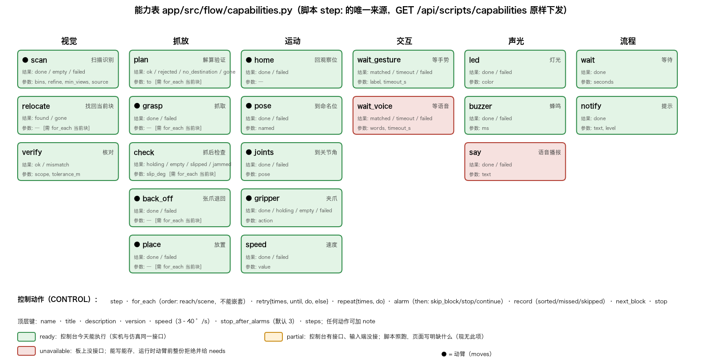

*图 2：能力表按组排列。● 表示动臂；绿色是 ready，红色是 unavailable。*

| 状态 | 含义 | 运行时 |
|---|---|---|
| `ready` | 控制台今天就能执行，实机和仿真同一接口 | 正常执行 |
| `partial` | 控制台一侧有接口，喂它的输入端没接 | 脚本照常运行，页面写明缺什么。**当前能力表里没有 partial 项** |
| `unavailable` | 板卡端还没有接口 | 脚本能写能存，但运行时在**动臂前**整份拒绝，并给出 `needs`，不会跑到一半停在桌面中间 |

当前有 20 项能力，只有 `wait_voice`（等语音）和 `say`（播报）是 unavailable：板上收音和音频输出都没接。

加能力的规则（AGENTS.md）：先在能力表里加条目，再在 `steps.py` 或 `actions.py` 里实现同名步骤。`tests/test_script.py` 核对两边一一对应。

### 脚本格式 v2

| 动作 | 写法 | 规则 |
|---|---|---|
| 执行能力 | `step: <能力>` + `with: {参数}` + `on_result: {结果: [动作], default: [动作]}` | 参数按能力表检查类型、枚举、范围。没写分支的不顺利结果：在 `retry` 里只结束这次尝试；在块内报警并跳过这一块；在块外整轮停。分支写成 `[]` 表示“这个结果是预期的”。不用 `on:` 是因为 PyYAML 会把 `on` 读成布尔 true |
| 对每一块 | `for_each: blocks`、`order: reach\|scene`、`do: [...]` | 不能嵌套 |
| 重试 | `retry: {times, until, do, else}` | `do` 最多做 `times` 次，最后一步结果等于 `until` 就停；都不行就做 `else` |
| 重复 | `repeat: {times, do}` | 1–1000 遍，“停止”随时有效 |
| 报警 | `alarm: <kind>`、`then: skip_block\|stop\|continue`、`summary` | 写 `alarm` 事件，`needs_ack: true`，要人确认 |
| 记一笔 | `record: sorted\|missed\|skipped`、`reason` | 只能在 `for_each` 里；写 `pipeline_*` 逐块记录 |
| 下一块 / 停止 | `next_block: true` / `stop: <原因>` | |
| 顶层键 | `name title description version speed stop_after_alarms steps` | `speed` 是本流程期间的控制台速度（3–40 °/s）；连续 `stop_after_alarms` 块报警（默认 3）就整轮停 |

**校验分两级。** 每条问题都带路径，例如 `steps[1].do[0].with.action`，网页点一下就跳到那一行。

- **错误**挡住保存和运行。例如：不认识的键、参数类型或范围不对、`record` 放在块外。
- **提示**不挡保存。例如：参数会被忽略、分支对应的结果这步不会给、用到 partial 或 unavailable 的能力。

### 示例：`gesture_sort.yaml`

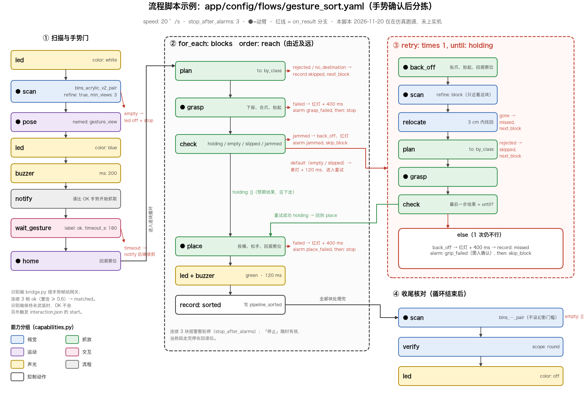

*图 3：`app/config/flows/gesture_sort.yaml` 的步骤图。2026-11-20 只在仿真里跑通，未上实机。*

```yaml
name: gesture_sort
title: 手势确认后分拣
speed: 20
stop_after_alarms: 3
steps:
  - step: scan             # 幻影门槛只用在这次带近看补拍的扫描上
    with: {bins: bins_acrylic_v2_pair, refine: true, min_views: 3}
    on_result:
      empty: [{step: led, with: {color: off}}, {stop: 桌上没有找到物块}]
  - step: pose
    with: {named: gesture_view}          # 平视位，腕部相机正对操作员的手
  - step: wait_gesture
    with: {label: ok, timeout_s: 180}
    on_result:
      timeout: [{step: notify, with: {text: 三分钟没等到 OK 手势，直接开始抓取}}]
  - step: home
  - for_each: blocks
    order: reach
    do:
      - step: plan
        with: {to: by_class}
        on_result:
          rejected: [{record: skipped}, {next_block: true}]
      - step: grasp
      - step: check
        on_result:
          holding: []
          default:
            - retry:
                times: 1
                until: holding
                do: [{step: back_off}, {step: scan, with: {refine: block}}, {step: relocate},
                     {step: plan}, {step: grasp}, {step: check}]
                else: [{step: back_off}, {record: missed}, {alarm: grip_failed, then: skip_block}]
      - step: place
      - record: sorted
  - step: scan
  - step: verify
    with: {scope: round}
```

（片段有删节：原文件带灯色和蜂鸣步骤，以及各步的 `failed` 分支。）

灯色约定：绿 = 放好，黄 = 夹空重试，红 = 失败，蓝 = 等人，灭 = 结束。

仿真结果（2026-11-20，`sim_server.py --map map_a4_v4 --bins bins_acrylic_v2_pair --speed 4`）：

- 扫描时幻影门槛去掉 1 处；
- 用 `bridge.py gesture --label ok --times 3` 报 3 帧，`wait_gesture` 给出 matched；
- 1 块放进 bin3，1 块没有对应的桶被跳过，1 块解算不通过被跳过；
- 收尾核对完成，退出码 0。

幻影门槛 `min_views: 3` 只用在开头那次带补拍的扫描上。仿真里，不近看的扫描会让真块只有 1–2 个视角，被当成噪声（[35](../../current/35-流程脚本与前端整理.md) §9.3）；实机 11-19 用同一门槛去掉 3 个幻影，没有误伤真块。

### 内置脚本库

脚本库分两处：`app/config/flows/` 是内置脚本，页面只读；`data/flows/` 存各端保存的脚本。

| 脚本 | 作用 | 状态 |
|---|---|---|
| `sort` | 完整分拣（分步编排），重试 2 次 | 仿真整轮通过；`--task flow` 时「开始」跑它 |
| `gesture_sort` | 手势确认后分拣 + 声光 | 仿真跑通 |
| `gesture_scan` | 等 OK → 扫描 → 回观察位，不抓 | 仿真 |
| `retry` | 单步执行 S5 时用 | 仿真 |
| `gripper_check` | 观察位张开 → 合拢 → 张开；合拢时夹到东西就停 | 仿真跑通（合爪给 empty） |
| `dance` | 预设动作：J1–J4 七个姿态，J5、J6 不动，最后回观察位；网关 `run_preset dance` 和语音“跳舞”都跑它 | 仿真跑通；姿态取自 11-19 中期演示用的保守版本 |
| `ready_signal` | 绿灯 + 蜂鸣 + 播报 | 用到 `say`（unavailable），运行会被拒绝；留作接口验收用例 |

### 触发与报警

- **谁能启动整轮。** 按钮、语音、手势、定时都走网关的 `start_task`；停止任何来源都可以发。
- **报警挡自动启动。** 有未确认的报警时，只有页面或 App 上人点的「开始」能启动，语音、手势、定时一律拒绝。
- **报警要人确认。** 报警需要人在任一端点“知道了”（`alarm_ack`）才清除。

## 接口设计

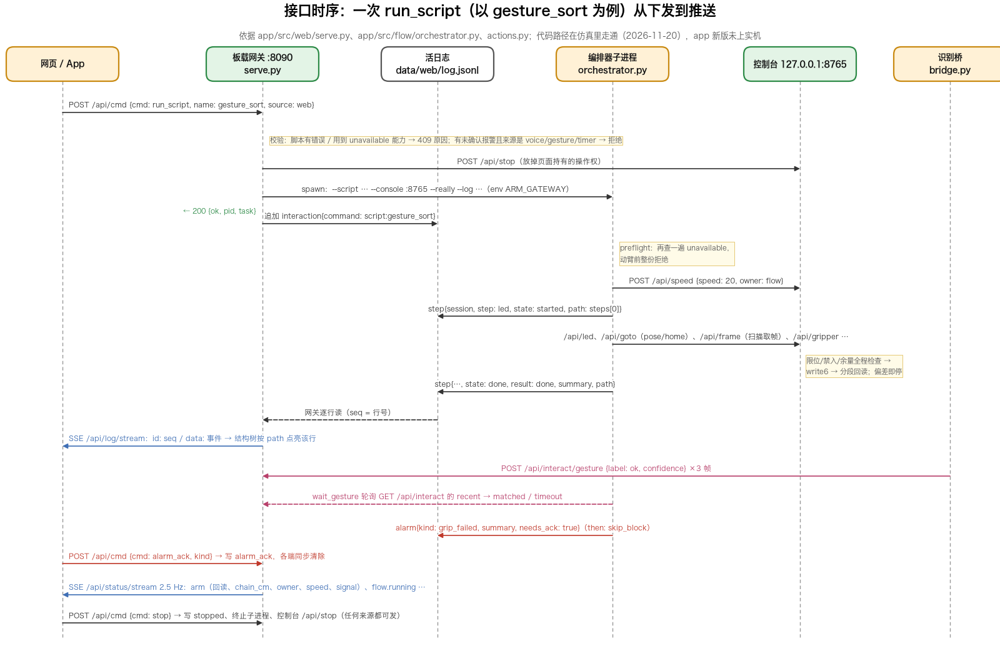

*图 4：一次 `run_script` 从下发到推送的接口时序。*

### 控制台 HTTP（127.0.0.1:8765，只给网关和任务子进程用）

POST 要带 `X-Console-Token`（从 `GET /api/bootstrap` 取）和 `owner`。第一条运动指令自动取得操作权；客户端在页面可见、App 前台或摇杆按住期间自动续租；300 ms 收不到 `drive` 就停在回读位。

| 方法 路径 | 用途 |
|---|---|
| `GET /api/bootstrap`、`/api/status` | 取口令；状态：回读 `pose`、指令 `command`、`owner`、`speed`、`drive`、`fk` 骨架点、`clearance_cm`、`grip`、`signal{led,beep}`、限位与禁入区 |
| `GET /api/frame`、`/api/precise`、`/api/export`、`/api/annotated/*` | 当前帧（转自相机服务）、精确回读、导出、标注图 |
| `POST /api/takeover`、`/api/heartbeat`、`/api/stop` | 接管（先 stop 再取得）、续租、停止（清空操作权） |
| `POST /api/speed {speed}` | 3–40 °/s，从下一段生效；分段 `max_step_deg`、`segment_ms`、`settle_ms` 由速度推出 |
| `POST /api/jog {joint, delta}`、`/api/cartesian {axis, amount}` | 单关节点动（\|delta\| ≤ 30°）；指尖沿 x/y/z（≤ 5 cm）或俯仰（≤ 15°） |
| `POST /api/goto {pose \| named, dry}` | 到绝对姿态或命名位（`observe_v1`、`upright`、`gesture_view`…）；全程检查通过才发；`dry` 只返回分段和余量 |
| `POST /api/drive {mode, v[], wrist}` | 摇杆连续驱动，客户端 10 Hz 刷新速度向量，分量范围 −1..1；`mode` 取 `cartesian` 或 `joint` |
| `POST /api/gripper {action}` | `wide` / `open` / `grip`；合爪后按回读给 `holding` / `empty` / `not_closed` |
| `POST /api/led {colour}`、`/api/beep {ms: 20–1000}` | 声光；仿真只记状态 |
| `POST /api/touch`、`/api/record`、`/api/sample`、`/api/calibrate`、`/api/verify`… | 细步触地、记录、采样、标定（调试用） |

### 网关 `/api/*`（0.0.0.0:8090，所有客户端的唯一入口）

**通用约定**

- `--lan` 时强制口令，请求带 `X-Token` 或 `?token=`。静态页面放行，进去后由页面带口令调 API。
- 写操作要求 `Content-Type: application/json`；`Origin` 和 `Host` 对不上的一律 403（防止跨源表单直接打到端口上）。
- 失败时返回 `{"error": "中文原因"}`：参数错是 400，冲突或被拒是 409，没接执行侧是 501。

| 方法 路径 | 用途 |
|---|---|
| `GET /api/health` | `contract_version`、`console_ready`、`console_sim`（仿真 / 实机按控制台自报的 mode 判断） |
| `GET /api/status`、`GET /api/status/stream`（SSE 2.5 Hz） | 状态推送：`mode`、`arm`（六轴回读、`chain_cm` 骨架、`tip_cm`、`owner`、`speed`、`drive`、`age_s`、`clearance_cm`、夹爪、`signal`、限位）、`flow`（子进程是否在跑、退出码、输出尾部、脚本名）、`listen`（识别端）、`timer` |
| `GET /api/log?after=&limit=`、`GET /api/log/stream`（SSE） | 日志契约事件；`seq` = 行号；SSE 带 `id:`，断线后用 `Last-Event-ID` 续传；静默 15 s 发注释行保活 |
| `GET /api/log/records`、`/api/log/summary` | 逐块记录（时间、类别、来源、目标、耗时、结果、轮次）、统计 |
| `GET /api/flow` | 编排器进程、未确认报警、步骤表、最近一次扫描的块和桶 |
| `GET /api/frame`、`/api/frame/stream` | 腕部相机：仿真是合成渲染，实机是真相机，路径同名同义 |
| `GET /api/blocks`、`/api/scene`、`/api/archive*` | 三维视图用的方块（仅仿真有真值）、扫描场景、未知物体存档图 |
| `GET/POST /api/timers` | 定时启动（启动时加 `--timers` 才启用；`board_up.sh` 目前没加，所以板上默认关闭） |
| `GET /api/interact`、`POST /api/interact/{arm,voice,gesture}` | 语音手势：武装开关、词表、阈值、最近识别 `recent`。判定在网关的 `intents.py`：手势阈值 0.6、连续 3 帧、冷却 2 s。结果 `accepted` / `ignored` / `rejected`，受理的写 `interaction` 事件 |
| `GET /api/scripts`、`GET /api/scripts/capabilities`、`GET /api/scripts/<name>` | 脚本列表（`builtin rev ok runnable uses moves unavailable partial errors warnings`）、能力表、单个脚本（原文 + 校验结果） |
| `POST /api/scripts/check {text}` | 只校验不保存 |
| `POST /api/scripts/save {name, text, rev?}`、`/delete {name, rev?}` | 存到 `data/flows/`；内置名或有错误的拒绝（400）；带 `rev` 且文件已被另一端改过 → 409 并附 `current`（乐观并发）；成功后写 `script_changed` 事件 |
| `POST /api/cmd` | 所有指令，见下表 |

### `POST /api/cmd` 的 cmd 字段

公共字段：`cmd`（必填），`source` ∈ `web / mobile / voice / gesture / timer / button`（默认 `web`）。

| cmd | 其他字段 | 说明 |
|---|---|---|
| `start` | — | 一整轮分拣：默认旧流水线，`--task flow` 时跑 `sort.yaml` |
| `run_script` | `name` | 跑一份脚本；有错误或用到 unavailable 能力时直接 409 |
| `flow_step` | `step`、`block?`、`session?` | 单独执行一步（scan / relocate / plan / grasp / check / retry / back_off / place / verify / home）；不给 session 就用最近一次的会话 |
| `stop` | — | 写 `stopped`、放开操作权、终止子进程、控制台 stop；任何来源都放行 |
| `alarm_ack` | `kind`（`*` 表示全部） | 确认报警，写 `alarm_ack` |
| `heartbeat` / `release` | — | 页面可见期间约 0.8 s 一次续租 / 切后台时只停续租，不停流程 |
| `takeover`（旧 `enable`） | — | 取得操作权 |
| `speed` | `speed` | 改速度，写 `speed` 事件 |
| `drive` | `mode`、`v[]`、`wrist` | 摇杆，透传给控制台，不占网关的运动锁 |
| `goto` | `pose` 或 `named` | 先 dry 再执行 |
| `gripper` | `action` ∈ `grip / open / wide` | 返回 `holding`、`readback` |
| `set_joints` / `move_to` | `joints_deg[6]` / `target_cm[3]` | 手动操作页的滑块和坐标移动 |
| `run_preset` | `preset` ∈ `dance / stack / carry` | 预设动作就是同名流程脚本；没有对应文件时返回 501（目前只有 dance） |
| `set_mode` | `mode` ∈ `manual / preset / auto` | 写 `mode_changed` |
| `listen` | `on`、`voice` | 开关识别桥子进程 |
| `led` / `beep` | `colour` / `ms` | 声光，经控制台 |

运动指令在网关里串行化：上一条没走完，新指令按 409 拒绝，不排队。

### 日志契约与推送

唯一来源是 `app/src/tools/log_contract.py` 的 `EVENTS` 表，契约版本 1。`app/contracts/log_event.schema.json` 由 `python3 app/src/tools/log_contract.py schema` 生成，测试保证三者一致（[18](../../current/18-日志契约.md)）。

- 日志每行一个 JSON，只追加，必有 `t` 和 `event`。
- 读的一方遇到不认识的事件跳过，不认识的字段忽略。日志里约四成是规划和调试事件，不在契约内。
- 改事件或字段，先改事件表，再重新生成 schema（AGENTS.md）。

| 类别 | 事件 |
|---|---|
| 一轮分拣 | `pipeline_start`、`pipeline_sorted`、`pipeline_missed`、`pipeline_skip`、`pipeline_approach_failed`、`pipeline_put_failed`、`pipeline_cleared`、`pipeline_stuck`、`pipeline_end` |
| 轮内进度 | `scan_view`、`gripped`、`put`、`pipeline_order`（就近顺序）、`pipeline_retry`、`pipeline_retry_failed`、`gesture_gate` |
| 故障 | `gripper_not_closed`、`gripper_awake`、`gripper_still_asleep`、`gripper_wake_refused`、`stall`（堵转）、`stopped`、`bin_full`、`table_z_disagrees`、`bins_located` |
| 分步流程 | `step`（`session, step, state` + 可选 `result, summary, block, path`）、`alarm`（`kind, summary, needs_ack`）、`alarm_ack`、`speed` |
| 交互与多端 | `interaction`（只记已受理的语音或手势指令）、`mode_changed`、`script_changed` |
| 拟定 | `unknown_object`（planned，还没有写入方） |

**推送机制**

- 事件用 `/api/log/stream`，状态用 `/api/status/stream`，两者都是 SSE。
- 编排器给每步的 `step` 事件带上 `path`（如 `steps[3].do[2]`），各端据此把正在跑的脚本行点亮。
- `script_changed` 让各端重新拉脚本列表。正在编辑的脚本被别人改了，就提示冲突。
- App 的任务页没有接 SSE，改为每 1 s 轮询 `/api/flow` 和 `/api/log`。

## 网页前端

位置在 `app/src/web/index.html` 和 `js/`（共 18 个模块）。无构建的原生 ES Module，由网关同源托管。页面只依赖日志契约和网关的 `/api/*`，实机和仿真共用同一套路径。

| 页 | 内容 |
|---|---|
| **作业台**（首页） | 现场画面：接仿真时内嵌仿真工作台的三维（`/sim/?embed=scene`）；接实机时按回读骨架画俯视 + 侧视图，点位来自网关转发的控制台正运动学 `arm.chain_cm`，不在前端再算一遍运动学。旁边是腕部相机，可切换并排 / 只看三维 / 只看相机。右侧：操作（开始、停止、选脚本运行、速度、夹爪、观察位、模式）、提示栏、设备状态。下方：流程进度（本轮计数、当前步骤、脚本结构树逐行点亮） |
| 流程脚本 | 脚本库（内置 + 已保存，标出动臂、不可运行、运行中）；结构视图可视化编辑（加能力或控制动作、上移下移、表单改参数、加结果分支）；YAML 原文编辑；能力表；单步调试 S1–S7；校验问题列表 |
| 手动操作 | 速度、夹爪、模式、关节滑块、坐标移动、小相机；扩展区放预设动作和语音手势调试输入，识别端开关 |
| 告警 | 待确认的报警、异常事件明细与筛选、未知物体存档图 |
| 记录与日志 | 统计、逐块记录、原始事件流 |
| 任务计划 | 定时启动 |
| 设置 | 网关和控制台连接、页面偏好、语音手势规则（只读）、“板卡端待接入”清单（来自能力表） |

**能力表驱动。** 页面启动时拉一次 `GET /api/scripts/capabilities`，脚本编辑器的可选步骤、参数表单、结果分支，以及设置页的“待接入”清单都按它生成。板上新增一项能力，前端不用改代码就能用。YAML 写回由 `js/yaml.js` 完成：5 份内置脚本写回文本再解析，结构完全一致。

**提示栏三级**（`js/notices.js`，作业台和告警页共用）：

- **报警**（红）：脚本发出的 `alarm`，要人确认；
- **告警**（黄或红）：日志里的故障事件，确认后写 `alarm_ack kind="notices"`，各端同步清掉；
- **状态**：断线、回读过期、操作权在别处等，条件消失就消失。

页头常驻一键停止。

**三维视图。** 仿真工作台（`dev/sim/web`）用课程 STL 网格，入库为 `dev/sim/assets/web_meshes.json`。11-20 起由画家算法改为软件深度缓冲，修正了方块、机械臂、底座方台之间的遮挡（提交 1b8d83b、b8d192e）。实机没有 `/sim/` 页，作业台改画回读骨架；`/api/blocks` 只在仿真里有真值，实机上返回空列表，不编造位置。

**验证。** 2026-11-20 在 Mac 上接仿真控制台验证过以下几项（[35](../../current/35-流程脚本与前端整理.md) §6），没有在实机上做系统测试：

- `gripper_check` 跑完，6 行逐行回填结果；
- 在网页上新建、保存并运行脚本，代发手势后流程走完；
- 报警的红条、角标、确认都正常；
- 375 px 宽时没有横向溢出。

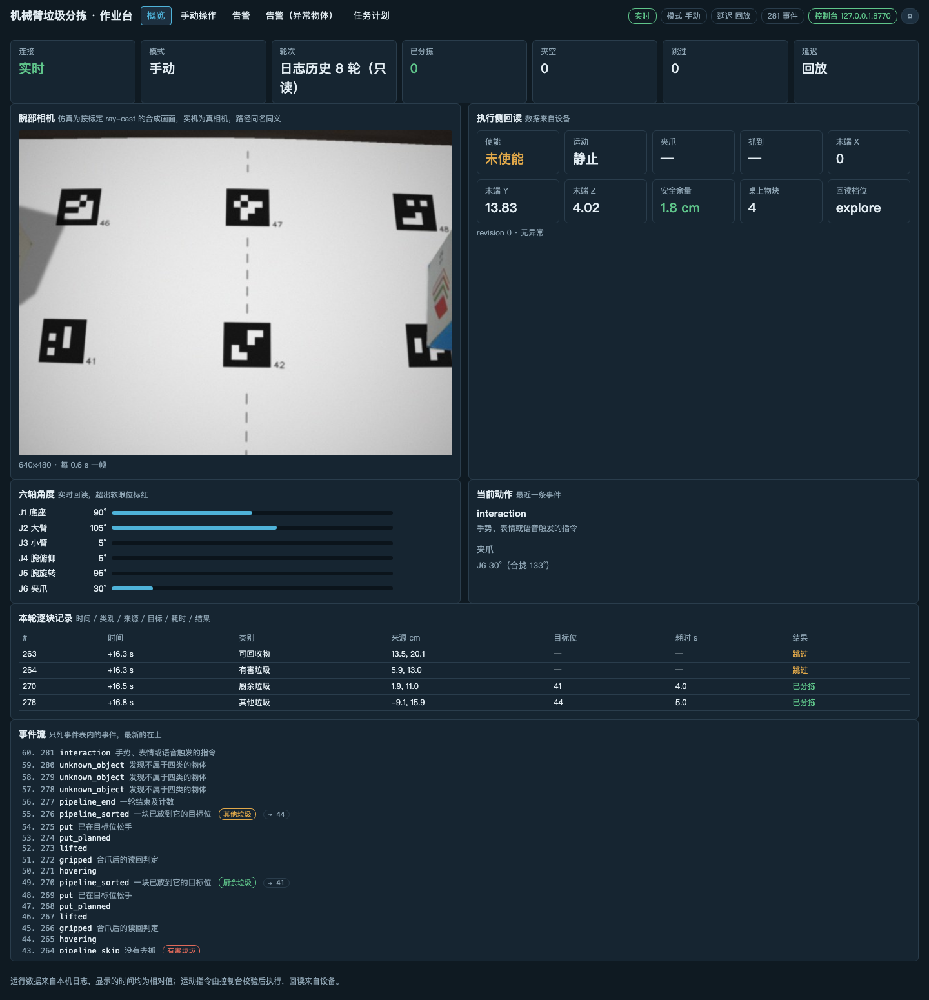

*图 5：**旧版**网页“概览”页截图（PR #1，2026-11-06，接仿真控制台 + 回放样例日志），取自本地 `.deploy/verify-2026-11-06/`。当前作业台已重做，仓库里没有新版截图。*

## 手机 App

位置在 `app/mobile/android`（Kotlin + Jetpack Compose，minSdk 24，targetSdk 36，包名暂为 `com.example.myapplication00001`）。同一个 App 有两个角色：跳板和控制端。App 不做安全判断，所有指令都是 `POST /api/cmd`、`source: "mobile"`（`ArmClient.kt`），网关拒绝什么就显示什么。

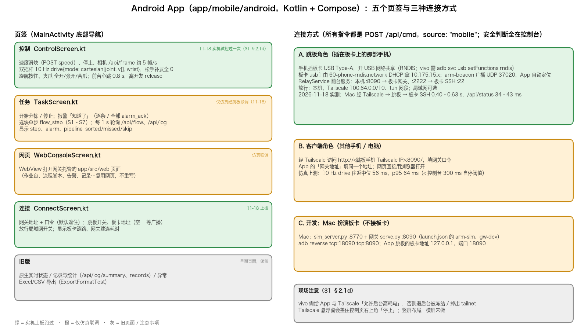

*图 6：App 的五个页签和三种连接方式。*

| 页签 | 文件 | 内容 |
|---|---|---|
| 控制 | `ControlScreen.kt` | 速度滑块、停止、相机（轮询 `/api/frame`，约 5 帧/s）；双摇杆 10 Hz `drive`，松手补发全 0：直角模式左摇杆管前后和 J1，右摇杆管上下和俯仰；关节模式管 J1–J4。旋腕按住、夹爪三键（全开、张开、合爪）。前台每 0.8 s 心跳，离开页面或退后台发 `release`，只停续租，不打断正在跑的流程 |
| 任务 | `TaskScreen.kt` | 开始分拣、停止；报警「知道了」（逐条或全部）；选块单步 `flow_step`；每 1 s 轮询 `/api/flow`、`/api/log`，显示 `step`、`alarm`、`pipeline_*` |
| 网页 | `WebConsoleScreen.kt` | WebView 打开网关托管的网页，复用作业台、脚本、告警、记录等页面，不重写 |
| 连接 | `ConnectScreen.kt` | 网关地址和口令（默认遮住）；跳板开关、板卡地址（留空就等广播）；放行局域网开关 |
| 旧版 | `MainActivity.kt` | 原生实时状态、记录与统计、异常；Excel/CSV 导出 |

**跳板与网络**（`relay/RelayService.kt`、`relay/Relay.kt`）

- **链路。** 手机插板卡的 USB **Type-A** 口，开 USB 网络共享（RNDIS）。板卡 Type-C 口是 RNDIS 网卡 gadget，手机内核没有 RNDIS 主机驱动，接不通（11-18 已排除）。板卡上的 `usb1` 经 DHCP 拿到 `10.175.15.x`。
- **转发。** 前台服务把本机 :8090 转到板卡网关，:2222 转到板卡 SSH :22。只放行本机、Tailscale 段 100.64.0.0/10 和本机 tun 网段；局域网需要在连接页打开。
- **定位与探测。** 收到 UDP 37020 广播就记下板卡地址；来自虚拟网的广播忽略。每 3 s 探测一次网关，结果写进常驻通知。
- **虚拟网。** 远程入网用 Tailscale。Mac 所在网络封了 ZeroTier 的 9993 端口，所以 11-18 从 ZeroTier 改成 Tailscale。跳板只做应用层转发，不依赖用的是哪家 VPN。

**实测**

- 2026-11-18，仿真：经跳板 10 Hz `drive` 往返中位 56 ms、p95 64 ms，远低于控制台 300 ms 的自停阈值；摇杆松手后 `drive.active` 立即变为 false。
- 2026-11-18，上板：
  - Mac 经 Tailscale → 跳板 → 板卡 SSH 0.40–0.63 s；
  - 拔掉网线后只经跳板完成了上载和起服务；
  - 用户在 App 上试控实机：速度改到 26 °/s，摇杆把手臂从观察位带走，夹爪张开、合爪、全开都执行了。期间 J4 指令 −10°、回读 −3°，控制台判“遇到阻力或偏差”，停在回读位并锁定，安全机制按设计生效。

**已知问题**

- vivo 手机要给 App 和 Tailscale 都开“允许后台高耗电”，否则退到后台会被冻结，或者掉出 tailnet。
- Tailscale 的悬浮窗会盖住控制页右上角的「停止」。
- 只做了竖屏，横屏未做。
- App 还没接 `/api/scripts*`：脚本列表、按 `path` 点亮进度都要等下一步（[35](../../current/35-流程脚本与前端整理.md) §8）。

### 缺口与不确定处

- **操作端互斥。** 网关是控制台唯一的客户端，网页、App、脚本经网关下发时，在控制台眼里是**同一个 owner**，彼此不互斥，指令可能交错。网关上的“当前操作端”还没做（[31](../../current/31-板载端分离与中继通信.md) §2.1d）。
- **人在现场的确认（B5）。** 编排器各步对现场确认自动答 yes，实机从网页运行只靠网页确认框。是否改成只在 `--onsite` 启动时放行，还没定（[35](../../current/35-流程脚本与前端整理.md) §7）。
- **相机服务监听范围。** 设计是只监听本机，但 `board_up.sh` 没传 `--host`，实际监听 0.0.0.0:8080。
- **文档与代码不一致。** 有几处文档描述已经过时：
  - `app/src/web/README.md` 还写着 `--onsite` 和使能；
  - `ready_signal.yaml` 的注释说 led、buzzer 没有接口，实际已是 ready；
  - `app/README` 的状态表写“手机双摇杆未上实机”，与 31 §2.1d 记录的 11-18 试控不一致，本文按 31 的原始记录写；
  - 定时启动在板上默认没开（`board_up.sh` 没加 `--timers`）。
- **还没量的数字。** 速度上限 40 °/s、实机上摇杆每段回读的耗时（实机回读 0.4–2.2 s 跳动）都没测过；实机上能否保持 10 Hz 驱动未知。

## 后续开发方向

| 方向 | 内容 |
|---|---|
| 收尾剩余功能 | 语音控制接入麦克风收音（WeNet 模型已上板，`wait_voice`、`say` 两项能力待接）；堆叠优先抓取、自动搭积木塔；记录导出补齐前端界面 |
| 新版上板 | 把 11-20 并入的 `app/`（分步编排器、YAML 脚本、能力表、识别桥）部署到板上，替换 11-19 的 PR #7 版；新规划器上实机执行 |
| 垃圾桶 | 桶尺寸卡尺验收；v4 地图单独做触点标定；改成下探到更低再松手，验证每桶 4 块；解决 3 号桶 J5 与 `normal` 档软限位冲突；新流程扫描避开桶禁入区 |
| 视觉 | ROI 棱边解算的实机精度与板上耗时统计；手势按验收口径（多会话、逐帧真值）测识别率，加手部区域检测缓解背景域差异 |
| 验收 | 连续 10 轮成功率统计；失败处理按口径量化（单次 ≤ 5 s）；12-18 交叉验收并冻结版本，12-25 结题答辩 |
| 第二阶段 | 实体桶扩到四类、扩充真实垃圾种类；多视角几何重建，抓取非方块物体 |
